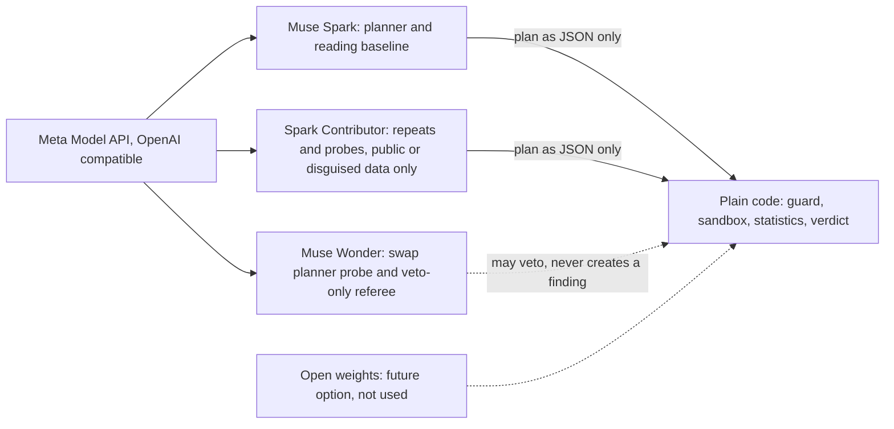
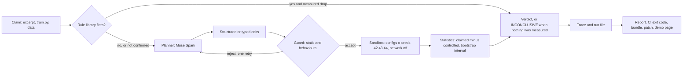
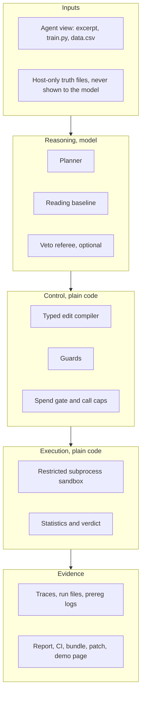
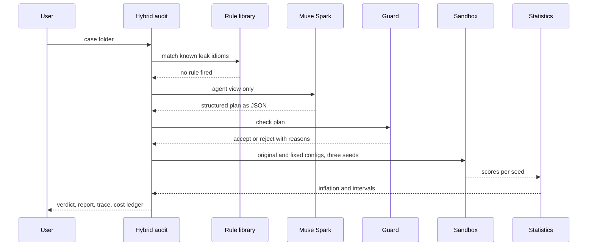
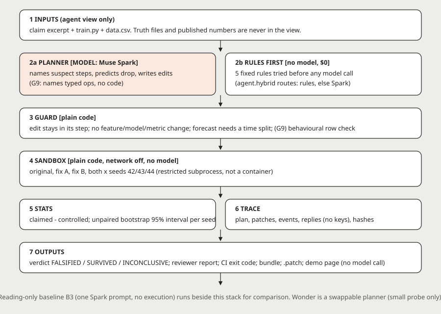
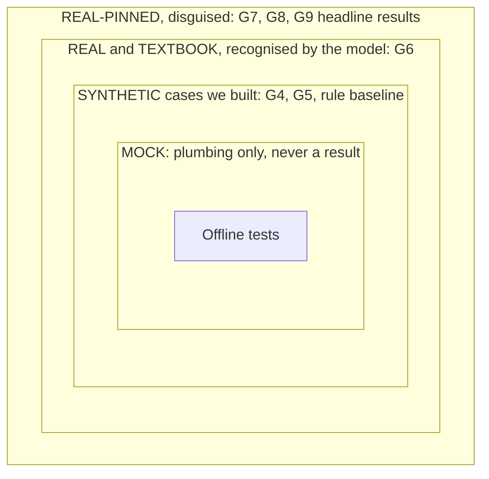

# NullLab

**NullLab re-runs the one evaluation step behind a published machine-learning score that looks suspect, and reports how much of the score that step accounts for, measured in a network-off sandbox, or INCONCLUSIVE when nothing was measured.**

Three headline facts, each a count with its n (details and caveats in [Results at a glance](#results-at-a-glance)):

- **0 of 5** false alarms on a correct ("clean twin") version of a disguised real published pipeline, in two separate runs (G7 and G8), where a reading-only prompt to the same model false-alarmed **5 of 5** (G7).
- **4 of 5** repeats measured an inflation within 0.15 of the published +0.36 on the leaky version (G8: +0.340, +0.339, +0.341, +0.328). The preregistered run before it, G7, **failed its bar at 3 of 5**. Both are shown side by side.
- **5 of 5** direction found and **0 of 5** false alarms on a second real dataset (G9 union, +0.424 in every repeat against an offline reference of +0.43), with the caveat that the five repeats gave identical numbers and that this dataset is not held out.

`tests: 452 collected (Nov 2)` | `rules-only path: $0, no key, no network` | `live model runs: CLI only, spend-gated` | `licence: MIT`

---

## Where the idea came from

**The problem.** Published ML scores do not always survive a re-check. A common cause is leakage: information about the test rows reaches training, so the reported number is higher than the method deserves. Kapoor and Narayanan's survey project lists errors of this kind in **41 papers across 30 fields**, which collectively affect **648 papers** ([reproducible.cs.princeton.edu](https://reproducible.cs.princeton.edu/), read Nov 2, 2026; taxonomy paper arXiv 2207.07048). That page gives no total of papers reviewed, so we state no percentage.

Reading a paper or its code tells you what *might* be wrong. It does not tell you *how much* of the headline number the flaw is worth, and a reader, human or model, can be confidently wrong about a pipeline that is fine. NullLab answers the narrower question: change only the suspect step, re-run, and measure the gap.

**How the idea took shape.** I came up with NullLab while doing my MSc, and I have kept brainstorming and refining it since, around my own fleet of AI agents: each round of review and testing narrowed the question until it was sharp enough to measure. The aim throughout was work that helps researchers directly, because they build on reported numbers, so checking the evaluation behind a result serves everything built on it.

1. **A narrow question.** Which part of a reported score is a flaw worth? Change only the suspect step, re-run it, and measure the gap.
2. **A check against prior work.** A review on Nov 1 found that agentic falsification is not new: the closest prior work is **Popper** (Huang et al., ICML 2025, arXiv 2502.09858), where LLM agents design and run falsification experiments. Static leakage detectors, checklists and reproduction agents also exist. The gap that survived the check is narrow: going from a leakage hypothesis to an executed counterfactual (same model, only the suspect step corrected) that reports how much of the score that step accounts for, with intervals and a clean-twin control. That is a search result; it does not rule out such a system.
3. **A pivot inside NullLab.** An early 9-case evaluation showed that a reading-only prompt matched or beat the executing loop (6 of 6 against 5 of 6 leaks found), because the cases rewarded naming a leak rather than sizing it. Tracing the cause moved the design to a 2x2 factorial (fix A, fix B, both) and then to real, disguised published cases with preregistered bars.

The idea predates the event; the code, experiments and results in this repository were produced during the Meta Global AI Developer Hackathon (Oct 26 to Nov 4, 2026), with coding agents including Meta's Muse Code. Third-party libraries and public data are listed in [NOTICE](NOTICE).

---

## How it uses the Meta ecosystem

All model calls go through the **Meta Model API** at `https://api.meta.ai/v1`, OpenAI-compatible chat completions, with the key read from the environment (`MODEL_API_KEY`, see `.env.example`). The model is chosen per role by environment (`NULLLAB_MODEL_<ROLE>`, else `NULLLAB_MODEL`, else `muse-spark-1.3`).

| Model | Role in NullLab | Evidence |
|---|---|---|
| **Muse Spark** (`muse-spark-1.3`) | Planner: names the suspect step or steps and proposes a fix as structured edits (typed operations in G9). Also the reading-only baseline (one prompt, no execution) every run is compared against. | Live runs G4 to G6 (`runs_g5/`, `runs_g6/`) |
| **Muse Spark Contributor** (`muse-spark-1.3-contributor`) | Cheap repeats and contamination probes for the headline runs (G7, G8, G9). Meta may train on data sent to it, so it receives only public or disguised data. | `runs_g7/`, `runs_g8/`, `runs_g9b/` |
| **Muse Wonder** (`muse-wonder-1.0`) | Swap-in planner, probed on 8 synthetic cases x 1 repeat (8 of 8 schema-valid plans). Optional veto-only referee in the hybrid audit (`--referee`): it can dispute a finding, never create one. The referee is untested live. No headline number uses Wonder. | [EVAL-7](docs/EVAL-7.md), [USAGE](docs/USAGE.md) |
| **Muse Code** | One of the coding agents used in the build. How much code it wrote is not measured: **UNVERIFIED**. | n/a |
| **Open weights** (Muse Glimmer, Muse Spark Open) | Not used. A future option for private data that must not leave the machine. **UNVERIFIED**: no local GPU, partner inference not built. | none |



**Where Meta is essential, and where it is not.** A fixed five-rule library with no model handles textbook leaks well: on the textbook and undisguised real cases it matched or beat the model loop, at $0. The model matters on the hard cases the rules miss. On synthetic hard cases the rules measured 0 on two cases (a look-ahead feature and offsetting errors) where the Spark loop got the sign in 3 of 3 each; overall the loop got 11 of 12 hard-case signs and the rules 6 of 12. On the second real dataset no rule fires at all, so the model path is the only candidate. The preregistered verdict on rules versus loop is **MIXED**, because the loop also had more clean false alarms (1 of 12 against 0 of 12). The product follows from this: rules run before the model, and Spark is called only when the rules cannot decide ([EVAL-8](docs/EVAL-8-RULEBASED.md)).

---

## Agentic architecture

The model proposes; code decides. Spark never executes code, never sees truth files, published numbers or the source name, and only returns JSON. Everything after the plan is deterministic code, and every number on every page is read from a run file.





| Part | What it does | Where |
|---|---|---|
| Planner | Names the suspect steps and returns edits as JSON. In the G9 runner it picks from four typed ops (`move_into_fold`, `drop_from_eval`, `replace_split`, `retrain_inside`); the hybrid audit's model path uses the earlier structured-edit planner | `agent/factorial_g9.py`, `agent/contract_g9.py`, `agent/factorial_g5.py` |
| Typed edit boundary | Compiles ops to code from AST templates; anything else is NOT_EXPRESSIBLE. Used by the G9 runner; not yet wired into the hybrid audit | `agent/edit_dsl.py` |
| Guards | Static fidelity (edit stays in its step; no feature, model or metric change) in the G5 to G8 runners and the hybrid audit; a forecast claim needs a time split (G7 and G8); in G9, a contract check plus a behavioural check of which rows are fit and which are scored | `agent/fidelity.py`, `agent/factorial_g7.py`, `agent/guard_g9.py` |
| Sandbox | Restricted subprocess: network cut, file allow-list, no process spawn, memory and process limits, scrubbed environment | `sandbox/`, [SECURITY](docs/SECURITY.md) |
| Statistics and verdict | Inflation = claimed minus controlled, mean over seeds, 95% unpaired bootstrap interval per seed; fails closed to INCONCLUSIVE | `sandbox/factorial_stats.py`, `sandbox/verdict.py` |
| Trace and replay | Every prompt, reply and measurement stored; a recorded run can be replayed with no call | `agent/llm.py`, `runs_*/` |
| Spend gate | Every live call passes a spend check and a per-phase call cap; the cost ledger reports calls, tokens and estimated USD | `agent/llm.py`, `agent/hybrid.py` |





Full contracts, module map and extension guide: [docs/ARCHITECTURE.md](docs/ARCHITECTURE.md).

---

## Who it is for and impact

| Who | What they need | Feature |
|---|---|---|
| Paper authors, before submission | Is my own number inflated, and by how much? | **Hybrid audit** (`agent.hybrid`): rules at $0, Spark only when needed, with a cost ledger |
| Reviewers | A checkable, hedged note rather than a verdict by impression | **Reviewer report** (`agent.audit`): claim, changed step, diff, claimed vs controlled per seed with intervals, what could not be tested, a short copyable note |
| Artifact-evaluation committees | Re-run the audit and check the files match | **Reproducibility bundle** (`agent.bundle`): hashes, patches, traces, report, standalone `rerun.py`, manifest, keys redacted |
| ML teams in CI | Fail a pull request when an evaluation inflates beyond a threshold | **CI check** (`agent.ci_check`): exit 0, 1 or 2; rules only, $0, no secrets |
| Anyone fixing a pipeline | The control as a diff | **Patch export** (`agent.patch_export`): unified diff with the measured effect in its header |

**What the evidence supports.** The problem is documented by others (41 papers, 30 fields, 648 affected papers). On one disguised real published pipeline, NullLab measured an inflation near the published value in 4 of 5 repeats (G8) and 3 of 5 (G7, bar failed), with 0 of 5 false alarms on the clean twin in both. A free, deterministic rule path exists for textbook patterns. Every number has its n and its file, and failures are shown at the same size as passes.

**What it does not yet support.** Any rate for papers in the wild, hours saved, or adoption: nobody outside the project has used NullLab yet. Every flaw tested so far was planted by us or documented by others, so discovery of unknown flaws is not shown.

---

## How it maps to the judging rubric

**Impact (30).** A documented reproducibility problem with a sourced size (41 papers, 30 fields, 648 affected papers), four named user groups, each with a concrete feature, and a $0 path that fits into CI. The impact claim stops at what the runs show; there is no user or hours-saved figure. Evidence: this README, [docs/EVAL-9-G8-RESULT.md](docs/EVAL-9-G8-RESULT.md), [docs/USAGE.md](docs/USAGE.md).

**Use of Meta AI tooling (25).** Muse Spark sits inside a verified loop as planner, and also serves as the reading-only baseline every result is compared against. The Contributor build carries the cheap repeats and contamination probes on disguised data. Wonder is a swap-in planner and a veto-only referee. The essential role of the model is measured, not asserted: rules suffice on textbook cases, the model is needed on the hard ones. Evidence: [EVAL-7](docs/EVAL-7.md), [EVAL-8](docs/EVAL-8-RULEBASED.md), `runs_g7/`, `runs_g8/`, `runs_g9b/`.

**Technical depth (20).** Preregistration with hash-frozen code, prompts and agent views (`python scripts/freeze_check.py verify`); a typed edit language as the tool boundary; static and behavioural guards; an unpaired bootstrap over three seeds; a 2x2 factorial for interactions; transport deadlines, retries and separate repair budgets; a hardened restricted-subprocess sandbox; trace and replay; a cost ledger. One preregistered run failed and is reported as failed. Evidence: [docs/ARCHITECTURE.md](docs/ARCHITECTURE.md), [EVAL-12 DSL](docs/EVAL-12-G9-DSL.md), [EVAL-12 instrument](docs/EVAL-12-G9-INSTRUMENT.md), [EVAL-14](docs/EVAL-14-GUARD-SPEED.md), [SECURITY](docs/SECURITY.md), `tests/`.

**Demo (25).** A replay-driven page built only from run files (no live call, no external request), a recorded hybrid audit run, and the misses shown beside the passes. Evidence: `python -m report.render`, `report/index.html`, `report/assets/recorded/`.

---

## Results at a glance

Counts, not rates. Three separately labelled runs on real public data, disguised (columns renamed, domain reworded, features rescaled; same rows), model `muse-spark-1.3-contributor`. They are **never merged or averaged**.

| | G7 (preregistered) | G8 (new labelled run, scored as frozen) | G9 union: second real dataset, 5 repeats | G9 union: headline-pair regression, 3 repeats |
|---|---|---|---|---|
| (a) Direction found on the leaky case | **3/5, bar of 4 FAILED** | 4/5, met | 5/5, met | 3/3, met |
| (b) False alarms on the clean twin (bar 0) | 0/5, met | 0/5, met | 0/5, met | 0/3, met |
| (c) Inflation within 0.15 of reference | 3/5, met | 4/5, met | 5/5 (+0.424 each; reference +0.43) | 3/3 (+0.332 each; published +0.36) |
| Harness failures (INCONCLUSIVE) | 2 of 10 | **1 of 10, target of 0 missed** | 0 of 16 across both G9 columns | |
| Reading only: leaky found / clean false alarms | 4/5 / 5/5 | not run | 5/5 / 0/5 (matched the loop) | 1/3 / 3/3 |
| Source | `runs_g7/score.json` | `runs_g8/score.json`, [EVAL-9](docs/EVAL-9-G8-RESULT.md) | `runs_g9b/score.json` | `runs_g9b/score.json` |

Read these with the results:

- **G7 failed its bar** (3 of 5). Two of its leaky repeats were harness failures (a sandbox crash on the only retry, an unparseable retry reply), counted as wrong by rule. Reading only was the better detector there (4 of 5 against 3 of 5). G8 is a separate run under the same frozen rules; it does not re-score G7, and n = 5 means one repeat can flip a clause.
- **G8's harness failure** was a read timeout after about 500 s, counted and not re-rolled. Measured values sit below the published +0.36: G7 +0.308, G8 +0.328 to +0.341; a Python port of the original pipeline measures +0.299 on the same rows.
- **The G9 repeats are identical**: the same plan and seeds gave +0.424 five times and +0.332 three times. n = 5 shows stability, not five independent confirmations.
- **The second dataset is not held out** for the typed edit language, which was designed after seeing earlier failures.
- **The temporal-split rule is stated up front** in the G9 contract, so the regression pair no longer tests whether the model finds that split itself. In G8, the guard rejected a random-split initial plan in 4 of 5 repeats, so the time split there came from the guard plus the model.
- **Reading only matched the loop** on the second dataset. The loop's clear edge is on the headline clean twin, where reading false-alarmed 3 of 3 (G9) and 5 of 5 (G7).
- **The fixed rules fire nothing** on the second dataset (0.000), and rules versus loop overall stays MIXED. The rules were not run on the disguised headline case.
- G9 ran 16 units in two parts: 8 before it stalled in a slow guard, and 8 (G9b) after a speed-up with identical decisions ([EVAL-14](docs/EVAL-14-GUARD-SPEED.md)). The stalled units had no observed outcome, so G9b is a continuation, not a re-roll.
- The disguise passed a 2-call probe: the model did not name the source. That does not show it has no memory of it.
- Estimated Meta spend G4 to G8 about USD 15.35 over 200 live calls; G9b about USD 1.6. Estimates, not billing.

Run-by-run results: [docs/EVAL-7.md](docs/EVAL-7.md), [docs/EVAL-9-G8-RESULT.md](docs/EVAL-9-G8-RESULT.md), [docs/EVAL-14-GUARD-SPEED.md](docs/EVAL-14-GUARD-SPEED.md). Synthetic hard cases and the rule baseline: [docs/EVAL-8-RULEBASED.md](docs/EVAL-8-RULEBASED.md).



Every number carries one of these labels. The outer ring is the strongest evidence; the inner rings test the machinery and are never quoted as headline results.

---

## Quickstart

Offline, no key, $0. Python 3.12. On macOS or Linux use `source .venv/bin/activate` and `python`.

```
python -m venv .venv
.venv\Scripts\activate
pip install -r requirements.txt
```

**Demo page** (built from run files, no model call):

```
python -m report.render
python -m uvicorn app.server:app --port 8099
```

Then open http://127.0.0.1:8099, or open `report/index.html` from disk. The server has no authentication: keep it on localhost.

**Hybrid audit** on a synthetic case (rules fire, verdict INFLATED, 0 model calls, $0):

```
python -m agent.hybrid corpus/leak_prescale --out out/hy --report out/hy.md
```

**Reviewer report** from a stored run:

```
python -m agent.audit corpus/leak_prescale --run runs_rulefix/leak_prescale.json --report out/review.html
```

**CI check** (exit 0 nothing above threshold, 1 INFLATED beyond it, 2 nothing audited or a measurement failed; a case with no rule fired is reported as not checked, not as clean):

```
python -m agent.ci_check corpus/leak_prescale --threshold 0.05 --summary out/summary.md
```

The rules-only workflow is in `.github/workflows/nulllab-audit.yml`; it has not yet run on GitHub (**UNVERIFIED**).

**Reproducibility bundle** and **patch export**:

```
python -m agent.bundle corpus/leak_prescale --run runs_rulefix/leak_prescale.json --out out/bundle.zip
python -m agent.patch_export corpus/leak_prescale --run runs_rulefix/leak_prescale.json --out out/fix.patch --base-out out/train.normalized.py
```

**Tests and freeze check:**

```
python -m pytest -m "not slow and not live" -q
python scripts/freeze_check.py verify
```

Live model runs (`--live`) are CLI only and pass a spend check before every call; without the spend-gate tooling they are refused, which is the intended fail-closed behaviour. A case is a folder with `train.py` (defining `load`, `feats`, `claimed_eval`), `data.csv` and, for reports, `excerpt.md`.

---

## Repository layout

| Path | Contents |
|---|---|
| `agent/` | Planner loop, typed edit language, guards, hybrid audit, reviewer report, CI check, bundle, patch export, model transport |
| `baselines/` | Reading-only prompt, five-rule library, checklist |
| `sandbox/` | Restricted-subprocess executor, resource limits, statistics, verdict |
| `eval/` | Case builders, host-only truth files, scoring |
| `corpus/`, `factorial/`, `real/` | Synthetic, factorial and real cases; real raw data rebuilt by script and pinned by checksum |
| `runs_*/` | The run files behind every number |
| `report/`, `app/` | Demo page (plain HTML, CSS and JS, no external requests) and a local FastAPI server |
| `docs/` | Evaluations, results card, architecture, deployment, security; index in [docs/README.md](docs/README.md) |
| `tests/` | Offline test suite with a mocked model |

Files that a preregistration hashed are frozen; do not edit them ([docs/FROZEN-FILES.md](docs/FROZEN-FILES.md)).

**Security.** The sandbox is a restricted local process, not a container boundary. It blocks network, file access outside the work directory, process creation and secret inheritance, and it is not designed to stop a determined attacker running native code. Do not point the CI check or the audit at code you do not trust. Details: [docs/SECURITY.md](docs/SECURITY.md).

**Deployment.** Local CLI and the rules-only GitHub Action are the supported paths; a hosted audit service is not recommended until a container boundary is verified. Runbook and pre-deploy checklist: [docs/DEPLOYMENT.md](docs/DEPLOYMENT.md).

**Licence.** MIT, see [LICENSE](LICENSE). Third-party data and services keep their own terms, listed in [NOTICE](NOTICE): the second real dataset derives from PhysioNet TPEHGDB (ODC-By 1.0, attribution in NOTICE), and the raw data of the headline case is not redistributed. Libraries used: scikit-learn, pandas, numpy, FastAPI, uvicorn, pytest.
