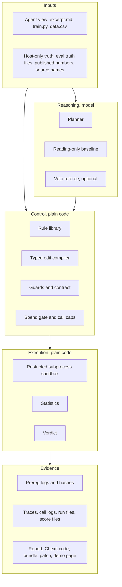
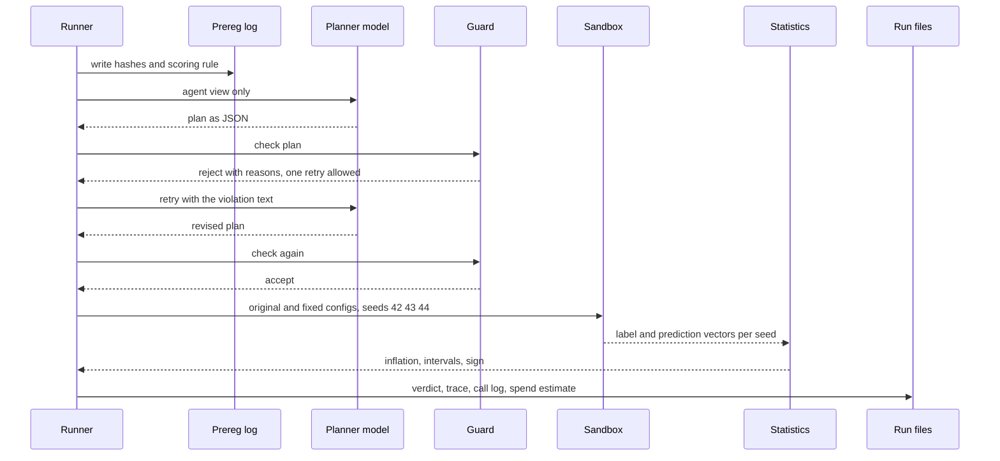
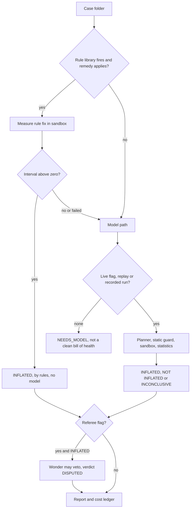

# NullLab architecture

Written 2026-11-02 from the code in this repository. Where the code and this page disagree, the code wins. Anything marked **UNVERIFIED** has not been tested on this project.

Contents: 1 Layers and contracts | 2 Data flow of one run | 3 Module map | 4 Typed edit language | 5 Guard and sandbox contracts | 6 Model adapter and roles | 7 Trace, replay and cost ledger | 8 How to extend | 9 Invariants | 10 Deliberately not built

---

## 1. Layers and contracts

NullLab has five layers. Each layer talks to the next through a file or a plain data structure, never through shared mutable state, so any layer can be replaced by a recorded file.

| Boundary | Contract |
|---|---|
| Inputs to model | The model sees only the agent view: the claim excerpt, `train.py` and a limited description of the data. Truth files, published numbers and source names stay on the host and are never placed in a prompt. Agent views of the real cases are disguised and hashed per run. |
| Model to control | The model returns JSON only. It never executes code. A reply that does not parse or does not fit the schema is a harness failure, not a finding. |
| Control to execution | Only code that passed the guard reaches the sandbox. The sandbox receives a copy of `train.py`, `data.csv` and the compiled patches, nothing else. |
| Execution to evidence | The sandbox returns per-seed label and prediction vectors. Statistics and the verdict are computed outside the sandbox by code the model cannot influence. |
| Evidence to output | Every page, report, CI message and bundle reads from run files. No output layer computes or invents a number. |

---

## 2. Data flow of one run

The research runners (G5 to G9) and the product hybrid audit share the same shape. The research path, as run in G9:

1. Build the agent view (excerpt, `train.py`, `data.csv`) and hash it.
2. Write the preregistration record: scoring rule, source-file hashes, prompt hashes, agent-view hashes (`runs_*/prereg_log.jsonl`). A later run refuses to start if the hashes differ.
3. Optionally make one reading-only call (B3) for comparison.
4. Planner call; parse the JSON; check the schema.
5. Guard: reject once with the reasons; separate repair budgets for a guard rejection, a crash and bad JSON.
6. Smoke pre-flight on 200 rows (G9).
7. Sandbox: original plus each fix (2x2 when there are two factors), seeds 42, 43, 44, network off.
8. Statistics: inflation = claimed minus controlled, mean over seeds, 95% unpaired bootstrap interval per seed (n_boot 1000). Sign from the interval.
9. Verdict, or INCONCLUSIVE with a reason.
10. Trace, call log and run file written; spend logged as estimates.
11. Report, CI exit code, bundle, `.patch` and the demo page read the files.

The hybrid audit (`agent/hybrid.py`) adds a rules step before the model:

Hybrid verdict values: `INFLATED`, `NOT INFLATED`, `NEEDS_MODEL`, `UNRESOLVED` (rules fired, no clear drop, model not consulted), `MEASUREMENT_FAILED`, `INCONCLUSIVE`, `DISPUTED`. Research-runner verdicts: `FALSIFIED`, `SURVIVED` (no evidence of inflation, which is not proof of absence), `INCONCLUSIVE`.

---

## 3. Module map

**Frozen** means the file is hashed by a preregistration and must stay byte-identical (after CRLF to LF normalisation) at the same path. The manifest is `docs/FROZEN-HASHES.json`; the checker is `python scripts/freeze_check.py verify`; deliberate post-tag changes (the 2026-11-02 sandbox security fix and the G9 guard speed fix) are recorded in `docs/FROZEN-CHANGELOG.json`. Full list: [FROZEN-FILES.md](FROZEN-FILES.md).

| Folder | Module | Role | Status |
|---|---|---|---|
| `agent/` | `llm.py` | Model transport, model choice per role, spend gate, call caps, traces, replay | **Frozen** |
| | `factorial.py`, `factorial_g5.py` to `factorial_g9.py`, `factorial_ehg.py`, `g4.py` (root) | Research runners per phase | **Frozen** |
| | `factorial_g9b.py` | Continuation runner for the 8 missing G9 units | Run evidence; preregistered in EVAL-15 |
| | `edit_dsl.py` | Typed edit language: op spec and AST compiler | **Frozen** |
| | `contract_g9.py` | Plan schema and the contract text given to the planner | **Frozen** |
| | `guard_g9.py` | Behavioural guard (row-level trace of what is fit and what is scored) | **Frozen**, speed fix recorded in the changelog |
| | `fidelity.py` | Static fidelity guard | **Frozen** |
| | `transport.py`, `smoke.py`, `cached_exec.py` | Deadlines and retries, 200-row pre-flight, cached sandbox worker | **Frozen**, security fix recorded |
| | `hybrid.py` | Rules before the model, cost ledger, optional referee | Product |
| | `audit.py` | Reviewer report (HTML or Markdown) from existing files | Product |
| | `ci_check.py` | CI entry point, exit 0, 1 or 2 | Product |
| | `bundle.py`, `patch_export.py` | Reproducibility zip, unified diff of the stored fix | Product |
| | `rules_measure.py` | Measures a rule fix in the sandbox without reaching into `eval/` | Product |
| | `extract.py`, `falsify.py` | Early (G0 to G3) single-experiment pipeline | Legacy product |
| `baselines/` | `rulefix.py` | Five-rule library R1 to R5 | **Frozen** |
| | `single_prompt.py`, `checklist.py` | Reading-only and checklist baselines | Product |
| `sandbox/` | `executor.py`, `run.py`, `run_factorial.py`, `factorial_stats.py` | Launch, worker, factorial worker, bootstrap | **Frozen**, security fix recorded for the first three |
| | `limits.py`, `verdict.py` | Resource limits, early verdict rule | Product |
| `eval/` | `build_g7.py`, `build_g8_cases.py`, `run_rulefix.py`, `regress.py`, `g7_truth.json`, `g8_truth.json` | Builders and host-only truth | **Frozen** |
| | other builders, `score.py`, `validate_dsl_replay.py` | Corpus builders, scoring, replay validation | Evidence tooling |
| `real/` | `ehg_disguised*`, and the disguised headline pair | Agent views of the real cases | **Frozen** (`train.py`, `data.csv`, `excerpt.md`) |
| `corpus/`, `factorial/` | case folders | Synthetic and factorial cases | Evidence inputs |
| `runs_*/` | score, trace, call and prereg files | The evidence behind every number | **Never edit**; prereg logs are append-only and pinned |
| `report/`, `app/` | `render.py`, `spa*.py`, `server.py` | Demo page and local server | Product |
| `tests/` | `test_g7.py`, `test_g8*.py`, `test_g9_runner.py`, `test_ehg_runner.py`, `test_guard_g9.py`, `test_dsl.py` | Tests pinning frozen behaviour | **Frozen** |
| | the rest | Offline suite with a mocked model and sandbox | Product |

---

## 4. Typed edit language: the tool boundary

In G9 the planner does not write code. It names operations from a frozen list and the harness compiles them from AST templates (`agent/edit_dsl.py`):

| Op | Parameters | Leak it controls |
|---|---|---|
| `move_into_fold` | step, call | A whole-data resampler, selector or fitted transformer runs before the split; run it per fold on training rows only |
| `drop_from_eval` | step, call | A label-using resampler or selector on the evaluation path; remove it |
| `replace_split` | step, kind (`random`, `group`, `temporal`), col | The hold-out or CV splitter in that step |
| `retrain_inside` | step | A model fitted once on all rows and reused across folds; refit inside each fold |

A plan names 1 to 3 factors. A request the ops cannot express is `NOT_EXPRESSIBLE`, which is recorded, never executed. The op list hash is frozen with the preregistration.

Why a typed boundary: free-form patches from the model changed more than the named step (a G4 clean false alarm dropped a legitimate feature and changed the CV scheme). A closed op set makes every executed change one of four reviewable shapes. Replay on 82 saved plans, no model, no spend: 0 crashes, 0 of 5 false rejects on known-correct fixes, 0 of 5 known-wrong ops accepted on clean twins, 29 of 82 plans NOT_EXPRESSIBLE ([EVAL-12-G9-DSL.md](EVAL-12-G9-DSL.md)). This is an engineering result on plans we had already seen, not a held-out test.

The hybrid audit's model path still uses the earlier structured-edit planner (`agent/factorial_g5.py`) with the static fidelity guard. Wiring the typed language into the hybrid audit is not built.

---

## 5. Guard and sandbox contracts

### Guards (plain code, no model)

| Guard | Checks | Cannot check |
|---|---|---|
| Static fidelity (`agent/fidelity.py`, G5 to G8 and the hybrid audit) | The edit stays inside its named step; no feature, model or metric change unless justified | Direction of the effect; whether the fix is the right one |
| Split use (`check_split_required` in `agent/factorial_g7.py`, G7 and G8) | A claim whose excerpt states a forecasting use must get a time split (SPLIT-USE-REQUIRED). Not applied in the hybrid audit | Same |
| Contract (`agent/contract_g9.py`) | Plan schema, op names and parameters, forecast rule stated up front | Same |
| Behavioural (`agent/guard_g9.py`) | Runs the compiled config once and records which rows are fit and which are scored, so it checks behaviour rather than constructor names | Same; one smoke run per check |

On rejection the planner gets the violation text and one retry. A second rejection is INCONCLUSIVE. The G9 guard was sped up after the G9 run stalled on the large case (1.2 s and 123 MB instead of more than 4 minutes), with identical decisions checked on 400 random traces, 500 random plan pairs, 7 real cases and all 82 replay plans ([EVAL-14-GUARD-SPEED.md](EVAL-14-GUARD-SPEED.md)).

### Sandbox (restricted subprocess, not a container)

Full detail and limits: [SECURITY.md](SECURITY.md). The contract in short:

- Inputs: a temp directory holding `train.py`, `data.csv`, the worker and the compiled patches. Truth files are never copied in.
- Order inside every worker: heavy libraries pre-loaded, then the network block and audit hook installed, then `train.py` imported. Top-level code of the audited pipeline runs under the block.
- Blocked: sockets, file access outside the work directory and the Python installation, paths naming truth files, process creation, links and renames, new native libraries. The environment is scrubbed, so no API key is inherited.
- Limits: wall-clock timeout with tree kill; Windows Job Object (memory per process, default 6144 MB via `NULLLAB_SANDBOX_MEM_MB`, active-process cap, kill on close); POSIX `RLIMIT_AS` and `RLIMIT_NPROC` (**UNVERIFIED**: not run on Linux or macOS). `NULLLAB_SANDBOX_REQUIRE_LIMITS=1` makes a failure to apply limits fail closed.
- Output: per-seed label and prediction vectors as JSON, or `status: error` or `timeout` with the reason.
- Docker: `sandbox/executor.py` has a Docker backend (`--network=none --read-only`, memory and pid caps) and a `Dockerfile` exists. It has **never been built or run: UNVERIFIED**. The single-experiment path selects Docker automatically when `docker info` answers; the factorial path always uses the subprocess. Set `NULLLAB_NO_DOCKER=1` to keep behaviour on the tested backend.

---

## 6. Model adapter and roles

`agent/llm.py` is the only module that talks to a model.

- Endpoint: `MODEL_BASE_URL` (default `https://api.meta.ai/v1`), OpenAI-compatible `/chat/completions`, bearer `MODEL_API_KEY` from the environment or a local `.env`.
- Model per role: `NULLLAB_MODEL_<ROLE>` (for example `NULLLAB_MODEL_PLANNER`), else `NULLLAB_MODEL`, else `muse-spark-1.3`.
- Before every live call: the per-phase call cap, then the spend check (`bs.py spend check`, the owner's budget tooling outside this repository). If the check is missing or refuses, the call raises `LiveNotAllowed`: live mode fails closed.
- Each attempt is logged before the request, so a failed call is still counted.

| Role | Default model | Used where |
|---|---|---|
| Planner | `muse-spark-1.3`; `muse-spark-1.3-contributor` in G7 to G9 | All model paths |
| Reading-only baseline (B3) | same as the planner of that run | Comparison only, never a verdict |
| Contamination probe | `muse-spark-1.3-contributor` | Disguise check before the headline runs |
| Referee | `muse-wonder-1.0` (`NULLLAB_MODEL_REFEREE`) | `agent.hybrid --referee`; veto only, max 10 calls; untested live |

The Contributor build may be used by Meta for training. Send it only public or disguised data.

---

## 7. Trace, replay and cost ledger

- **Call logs:** `runs_*/live_calls_*.jsonl`, one line per attempt (model, estimated USD, tag, role, temperature), written before the request.
- **Traces:** `runs_g7/traces.jsonl`, `runs_g8/traces.jsonl` and the G9 run folders hold every prompt and reply.
- **Replay:** `agent.llm.set_replay(<traces.jsonl>)` serves recorded replies keyed by prompt, role and model; a prompt with no recording raises a replay miss rather than calling out. Replayed calls book $0. The hybrid audit also serves a recorded Spark run of the same case from the repository, tagged `Spark (recorded run, no new call)`. A full replay of the G7 loop through the sandbox exists (`python -m agent.factorial_g7 --replay runs_g7/traces.jsonl --out <dir> run`) but was not re-run for this document: **UNVERIFIED**.
- **Cost ledger:** the hybrid audit reports calls, estimated tokens (4 characters per token) and estimated USD per model, with replayed calls counted separately. USD is the per-call estimate the spend gate uses (0.10 per planner call), not billing.
- **Score files:** `runs_*/score.json` hold the counts every page quotes.

---

## 8. How to extend

Do not edit a frozen file. Extensions go in new modules or new versions so that every recorded hash keeps describing what ran.

**Add a case.** Create a folder with `train.py` defining `load`, `feats` and `claimed_eval`, a `data.csv` and an `excerpt.md` with the claim text. For an evaluation case, put the truth (expected direction and size) in a host-only file under `eval/`, never in the case folder. Label it (MOCK, SYNTHETIC, TEXTBOOK or REAL-PINNED) and, for real data, pin the raw download by checksum and add the attribution to `NOTICE`. Run `python -m agent.hybrid <case> --out out/x --report out/x.md` to check it executes.

**Add a rule.** `baselines/rulefix.py` is frozen. Write a new rule module (for example `baselines/rulefix_v2.py`) that returns the same `detect` and `build_configs` shapes, point `agent/hybrid.py` at it through its `detector` and `measure` arguments, and add tests. State in the report which rule set produced a verdict. Re-run the rule baseline under its own preregistration before quoting it.

**Add an op.** `agent/edit_dsl.py` is frozen and its op-spec hash is in the G9 preregistration. Create a new versioned module with the extended spec, a new spec hash, a guard rule for the new op and replay tests in the style of `eval/validate_dsl_replay.py`. Any live run on it needs a new preregistration.

**Add a model adapter.** `agent/llm.py` is frozen. For a model behind an OpenAI-compatible endpoint, set `MODEL_BASE_URL` and the role variables; nothing else changes. For a different transport (for example open weights served locally), write a new adapter module exposing the same `live_complete(system, user, ...)` signature, keep the spend gate and call cap in front of it, log each attempt before the request, and inject it in tests the way `agent/hybrid.py` injects `spark_runner`.

**Add an output.** Read only from run files. If an output needs a number that no run file holds, add it to the run file in a new run rather than computing it in the output.

---

## 9. Invariants

1. **The model proposes and code decides.** The model returns JSON; plain code compiles, guards, executes, measures and decides the verdict. A model can veto (referee) but never create a finding.
2. **Every number comes from a run file.** Reports, pages, CI messages and bundles read files; they do not compute new results.
3. **Fail closed to INCONCLUSIVE.** A crash, timeout, unparseable reply, exhausted retry, missing measurement or refused spend check yields INCONCLUSIVE, NEEDS_MODEL or MEASUREMENT_FAILED, never a clean verdict. "No rule fired" is reported as not checked.
4. **The model never sees truth.** Truth files, published values and source names stay on the host; the sandbox never receives them.
5. **Preregistered inputs are frozen.** Hashes are written before a live call and checked before any run that depends on them; prereg logs are append-only.
6. **Harness failures are counted, never re-rolled.**
7. **Runs are never merged.** Separately labelled runs (G7, G8, G9) are reported side by side.
8. **No secret leaves the environment.** Keys come from the environment; the sandbox environment is scrubbed; bundles are scanned and redacted.

---

## 10. Deliberately not built

- A container or microVM boundary that has been tested. The Docker path exists and is untested.
- Live model calls from the web server. `POST /api/run/{case}?mode=live` is refused; live runs are CLI only.
- Authentication, rate limiting or multi-user support in `app/server.py`.
- An up-front manifest of what a live prompt sends off the machine (the prompt builders and call logs are the record).
- The typed edit language inside the hybrid audit.
- Open-weights inference.
- An adversarial prompt-injection test set.
- Hash-locked dependencies.
- Any rate estimate for papers in the wild. Results are counts on cases we built or picked.
