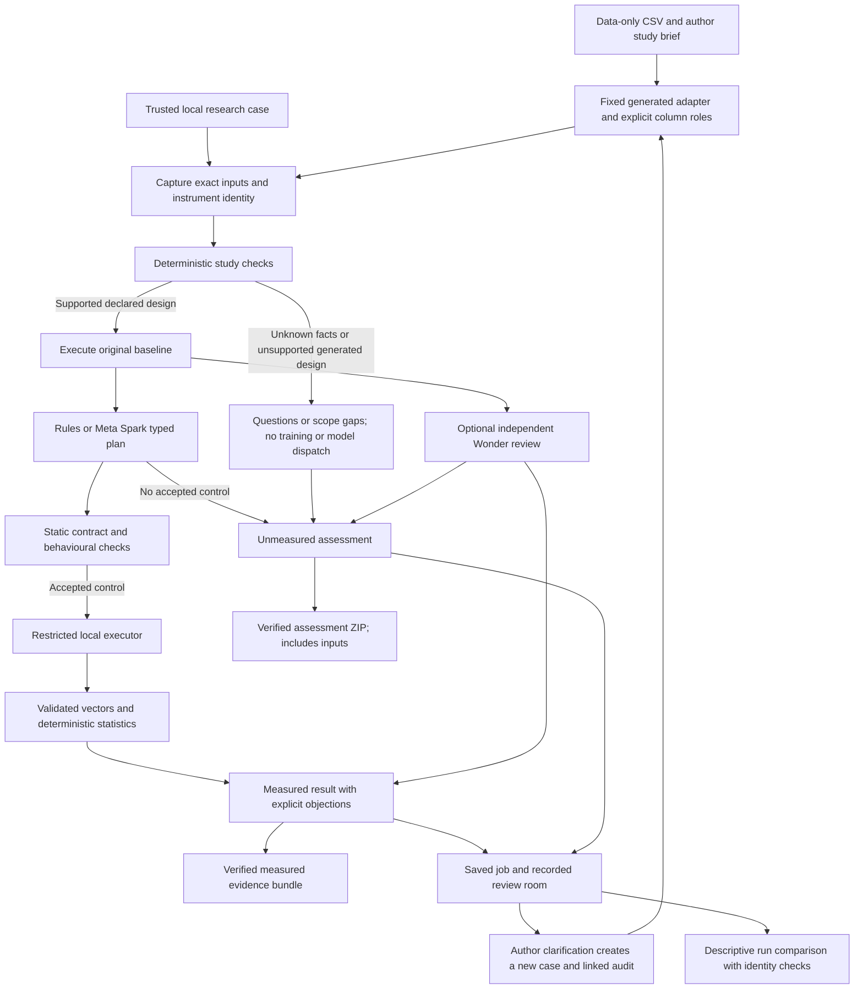

# NullLab v2 architecture

The supported entry point is `agent.engine.run_audit`. CLI, local web jobs and default CI call this engine. Earlier generation runners are historical experiments; their results do not validate v2 automatically. The researcher workflow adds an input-version and review layer around this measurement path, rather than a second experimental engine.

## Study boundary and input revisions

`agent.study` normalizes a bounded author declaration: decision time, unit of analysis, intended population, predictor availability, entity/time metadata and exclusions. `agent.intake` retains the supplied CSV bytes and creates a fixed binary Random Forest pipeline using the selected numeric predictors. Metadata and explicit exclusions remain in the data snapshot but do not become generated predictors. Missing selected values receive fixed zero replacement; this is recorded, not a claim that zero is scientifically appropriate.

Generated-adapter role enforcement requires the trusted template to match the source being evaluated. Merely checking a `PREDICTORS` constant does not establish which columns a customized function uses. Edited research code must be handled as trusted custom code with an explicit unverified-role warning, or rejected when it still claims the fixed generated adapter. No user Python is executed on the host to infer its features.

Missing decision-time/availability/population information produces `NEEDS_INFORMATION`. A generated unseen-entity or future-record request is `UNSUPPORTED` when the required information is complete: random-row CV is not silently substituted for a group/time evaluation. These gates precede baseline fitting and provider construction. Represented-entity studies may run a descriptive record baseline, but their dependent records cannot support the instrument's positive-effect conclusion. Legacy trusted cases without a structured brief retain a visible undeclared-contract warning.

These fields express **author declarations**, not independently verified facts. Aggregate diagnostics such as target-matching columns, repeated predictor rows and missing values are review prompts, not automatic leakage findings. The study and diagnostics are included in the model context when a hosted audit is explicitly requested.

The API creates a fresh generated case for a clarification, preserving the prior case and result. Its lineage records parent input hashes, parent case/job, reason and timestamp; a linked audit manifest is verified and recorded when available. A source case changed since that linked audit is refused. Saved job snapshots bind exact bytes; a local case directory remains owner-editable. A new declaration must pass the checks and be audited again. It never upgrades an earlier result or supplies an empirical control retroactively. Saved intake aggregate profiles require a matching data hash and predictor metadata; execution recomputes the facts.

## Measurement and model roles

`agent.evidence` pins exact input bytes, control sources, context, environment and instrument identity. The engine captures before running and verifies afterward. Artifacts are job-scoped and atomically written. `agent.provider` is instantiated per job; it has no process-global provider substitution, private credential-file fallback or dependency on battle-station. Every network attempt reserves a conservative estimate before dispatch, with a durable per-job lock and ledger. This is a per-job budget, not a cross-account billing guarantee.

The planner uses the typed G9 operation compiler and contract, followed by its behavioural guard. Only accepted controls proceed to full measurement. The engine repeats the original and refuses attribution if predictions change between baseline and intervention execution. Host statistics reject malformed/nonfinite vectors. All three seed signs must agree for the v2 positive-effect conclusion; mixed evidence is inconclusive.

Wonder first reads original evidence independently. A later bounded review can dispute the proposed control and interpretation. Failed, malformed or disputed reviews are not passes. Initial objections survive a planner's no-flaw early return. Missing-information questions and unsupported-concern scope gaps do not extend the edit compiler. A critic's quality benefit over a matched one-planner baseline has not been established by the current pilots.

The runtime guard preserves identity through exact allow-listed row-preserving sklearn scaler types; custom subclasses do not inherit that assumption. Missing scoring-model identity is unverified. Group/time controls remain descriptive/inconclusive because row dependence and the required uncertainty contract are not validated. The [fixed eight-case follow-up](EVAL-V2-FOLLOWUP.md) retains original coverage failures separately from later development regressions.

## Workspace and exports

FastAPI exposes local-only intake, generated-case revisions, job creation/status/cancellation, saved history, curated recordings, comparison and export. The two-worker queue and four-job cap bound local concurrency. Cancellation is cooperative between bounded stages, not immediate provider cancellation. Interrupted queued/running jobs are marked failed after server restart; they are not silently resumed with reused numbers. The client tracks the active audit separately from the displayed saved record, so reopening history does not change the audit being polled or cancelled.

Monotonic view/detail request generations prevent late responses from replacing a newer saved record or recording. Export links bind to the rendered job. If a terminal job disagrees with its saved checkpoint, the UI shows the terminal failure and hides exports; history/comparison do not treat the checkpoint as finalized measurement. Shared atomic JSON storage retries transient sharing locks for at most 0.63 seconds and preserves the prior complete checkpoint on permanent failure.

The review room is derived from recorded deterministic checks, planner/critic responses and execution. It is not simulated conversation, a vote or evidence of agent consensus. The room shows questions and scope gaps that can motivate a new author revision. A broad literature or dataset-search agent is not part of this shipped measurement contract.

Measured bundles require verified control and input identities. `agent.assessment` supplies a distinct assessment ZIP for terminal outcomes without a measured control, including gated, baseline-only and failed outcomes when a verified input snapshot exists. It explicitly states that no counterfactual was measured. Both export paths include only manifest-bound inputs, reject credential-like text and preserve private-data sharing warnings. An assessment ZIP includes source and data; it is not a data-free memo.

Comparison first verifies each saved snapshot, then reports differences in input/source, instrument, environment, context, metric and seed metadata. It supplies no new statistical test, causal delta or model ranking. Matching metadata alone does not establish scientific equivalence; differing populations or revised assumptions must not be ranked as if they were controlled interventions.

## Validation boundary and extensions

The discussion, synthetic workflow probes, API checks and minimal-DOM checks are internal development evidence. They are not external researcher interviews, a browser walkthrough, a fresh estimate of scientific accuracy or measured time savings. See [research-room decisions](reviews/research-room/DECISIONS.md) and [researcher roadmap](RESEARCHER-ROADMAP.md).

A compatible local model endpoint is supported, including explicit instance replay with exhaustion. Glimmer runtime/model quality, production multi-user service, container isolation and cross-platform behavior require separate validation. See [security](SECURITY.md) and [deployment](DEPLOYMENT.md).
