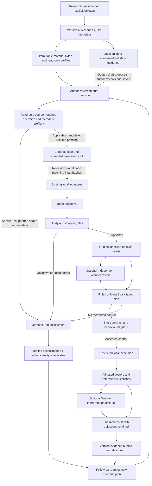

# NullLab v2 architecture

The Research Workdesk is implemented as an investigation and review layer around `agent.engine.run_audit`. It stores the research question, materials, author-reviewed brief revisions, prepared plans and links to existing engine jobs. It does not introduce a second scorer or derive scientific verdicts from chat. The [workdesk implementation record](plans/RESEARCH-WORKDESK.md) separates this supported slice from deferred design goals.

| Route | Purpose | Execution boundary |
|---|---|---|
| `/` | Hero, method and scope/evidence introduction | Continuous explanatory animation; no investigation, model call or audit starts on page load. |
| `/workdesk` | Start with the researcher's question and materials; review a brief/plan, run and inspect results | Explicit actions create metadata, attach inputs or start an acknowledged job. Examples are secondary input copies. |
| `/evidence` | Read-only Evidence Lab: “From claim to evidence”, curated recordings and saved job history | Recordings stay labelled; opening evidence never reruns it or calls Meta. |
| `/architecture` | Inspectable explanation of model, guard, execution and evidence responsibilities | Steps 01–08 run in one vertical sequence; the selected explanation opens directly underneath. Downward connectors and Up/Down/Previous/Next navigation preserve that order. Animation is explanatory, not live agent activity. |

Existing `/?job=UUID` links open Evidence Lab. Shared navigation uses locally bundled Space Mono and Inter. Landing and architecture animations have pause/reduced-motion behavior. Workdesk content can scroll and does not require fullscreen. Desktop and mobile share the investigation state through Research, Study brief, Results and Materials views. The [Workdesk validation record](reviews/2026-11-04-workdesk-validation.md) reports actual current-source checks; publication remains separate.

## Investigation state and inputs

`agent.workdesk.WorkdeskStore` uses standard-library SQLite under ignored `out/workdesk/investigations.sqlite3`. Investigations contain the question, messages, material metadata, current/historical briefs and plans, and run links. Transactions are short; inference and execution do not hold a database transaction open. Existing job files and `agent.storage` remain the result/artifact store.

Materials use generated UUID filenames under `out/workdesk/materials`; original filenames are metadata, not paths. The store rejects directory components, unsupported suffixes, unsafe storage symlinks and changed/missing bytes. Uploads retain exact UTF-8 source bytes, including line endings; invalid UTF-8 is rejected. SHA-256 is checked on reads and before live guidance or plan compilation. Hashes detect changes; they do not authenticate the author's assertions.

| Input or limit | Implemented behavior |
|---|---|
| Question | Required to create a project, 1–4,000 characters. A question alone does not produce an experiment. |
| `.csv` | Up to 5,000,000 bytes per user upload; 30–20,000 rows and 2–1,000 columns. Target must be nonmissing binary 0/1 with at least five records per class. |
| `.py` | Up to 256,000 bytes. AST inspection checks top-level `load`, `feats` and `claimed_eval`; it never imports or executes the file during intake. This checks shape compatibility, not scientific validity or safety. |
| `.txt`, `.md` | Up to 256,000 bytes each; author context, not independently verified evidence. |
| Capacity | At most 20 materials per investigation and 200 investigations. The HTTP material request cap is 7,000,000 bytes, accommodating base64 transport. |
| Examples | Explicit transactional copy of SECOM/SECOM-clean data, pipeline and notes. A separate 50 MB local-case CSV allowance accommodates the bundled public example; no recorded result is copied. |
| Notebook, PDF, repository URL or unsupported research task | No retrieval/execution adapter is supplied. Unsupported file types are rejected with a scope explanation. |

A brief uses the latest CSV and, in supplied-pipeline mode, latest Python. Older versions remain attached. Arbitrary selection of older materials, project/material deletion, importing arbitrary saved jobs into a project and a durable issue-resolution ledger are not implemented.

CSV-only work creates the fixed binary Random Forest baseline using selected numeric predictors. Missing selected values receive fixed zero replacement, recorded as a protocol choice rather than scientific justification. Target, entity/time metadata and explicit exclusions are omitted from generated predictors. The generated adapter's normalized AST must match its trusted template; retaining a `PREDICTORS` constant cannot make a customized function satisfy that contract.

Supplied-pipeline mode preserves the compatible Python and CSV bytes and requires explicit trusted-local-code acknowledgement tied to the selected Python material. A literal `TARGET`, when present, must match. The compiled case passes `engine.preflight` before dispatch. Execution remains trusted local Python under the existing restrictions, not a public hostile-code sandbox. Custom-code predictor roles remain unverified; the supplied model is not silently replaced by the generated classifier.

## Declarations, plans and immutable runs

`agent.study` normalizes decision time, unit of analysis, intended population, predictor availability, entity/time metadata and exclusions. These are **author declarations**, not established facts. Missing information produces questions before training/audit-model dispatch. Unsupported generated unseen-entity/future-record requests produce scope gaps instead of random-row substitution. Represented-entity/group/time results cannot gain the instrument's positive-effect interpretation through the UI. Legacy cases without a structured brief retain their undeclared-contract warning.

Saving a brief appends a revision with a parent revision ID and material IDs. Attachments invalidate the plan and mark an existing brief for review. A ready plan compiles a new case and records the investigation ID, accepted brief/hash, plan ID, root question, material IDs/hashes and exact `agent/workdesk.py`/`app/workdesk_api.py` source hashes. Question, intended use and bounded author-note excerpts enter the engine context snapshot. Truncated notes are marked; unfrozen chat is not silently added to the experiment.

`agent.workdesk_protocol` adds a deterministic check before case publication or dispatch. Required group/time operations are dry-compiled using the unchanged frozen DSL, and only reachable, explicitly bound group helpers are recognized. Group/time metadata must currently be complete, finite numeric identities without unsafe precision or identity collisions; the runtime guard cannot trace arbitrary categorical IDs. A blocked plan explains how to prepare a separate reviewed adapter/metadata revision while preserving original inputs and baseline behavior. No code is imported during this check. Static applicability is narrower than runtime guard acceptance, and both are distinct from a measured comparison.

Prepared plans expose target, metric, fixed seeds, intended population, column roles, source hash and static candidate operations. A candidate is not a locked Meta proposal: acknowledged Meta planning still reasons independently and may select another supported intervention or abstain. Runtime provenance and fidelity checks still decide whether a proposed control can be measured. The case snapshot also records the exact `agent/workdesk_protocol.py` hash.

Guidance receives confirmed author-reviewed fields and grounded, unconfirmed proposals separately. Proposed values require exact quotes from user messages or attached notes, valid columns/enums and current material identity. The interface copies suggestions into a draft; saving the brief is still the author's confirmation, and Python trust remains separate. Repeated resolved intake questions are filtered without editing raw provider traces or suppressing new methodological objections. Late responses cannot override a later author-reviewed brief. This is a bounded clarification mechanism, not a general autonomous research memory.

Starting requires the reviewed `plan_id`, current accepted brief, unchanged material selection and matching compiled input hashes. Material/brief/plan/example mutations are blocked during that investigation's active audit. Chat can continue but cannot mutate the frozen job. A dispatch lock protects job creation/linking; if metadata linking fails, the queued job is cancelled before execution. Prior briefs, plans, cases and results remain intact; changed declarations need a new plan and explicit run.

The older generated-case clarification API also preserves parent input hashes, parent case/job and a verified linked-audit identity when supplied. Saved aggregate profiles require matching hashes/roles; execution recomputes diagnostics. Revisions never upgrade earlier outcomes or supply an empirical control retroactively.

## Guidance, Meta roles and spending

The deterministic local study guide is labelled and works without a key. Hosted guidance is a separate non-executing task, enabled only with `NULLLAB_ALLOW_WEB_LIVE=1`. Its unmeasured reply records the actual `provider.model_for("intake")`; it cannot accept a brief, run code or clear an empirical concern. Schema validation limits references to attached material IDs. Stable question IDs, sentence-level citations and automatic field-level attribution remain future work.

Before hosted guidance, an acknowledgement binds `context_sha256` to the question, material IDs/hashes, accepted brief, recent thread and latest run context. The server checks that hash and material bytes under its lock, then uses the authorized snapshot without holding the lock through inference. A changed context requires renewed acknowledgement. Guidance sends CSV columns/aggregate profiles, bounded code/notes excerpts and recent messages, **not sampled raw CSV rows**. Code, prompts and notes can themselves contain private data.

Guidance uses the **latest linked run**, even if Results displays an older selected run; the client identifies this boundary. Numerical context is supplied only when terminal job/checkpoint status agrees and saved evidence/record identity verifies. Pending or unverifiable checkpoints are not quoted as completed measurement.

The audit planner defaults to `muse-spark-1.3`; the optional critic defaults to `muse-wonder-1.0`, subject to explicit provider configuration. Wonder independently reviews original evidence using the same edit contract before Spark plans. `supported` means testable within that contract, not “the pipeline is correct.” `unsupported` needs a concrete edit-list gap; `needs_information` needs questions. After measurement it can dispute the control/interpretation. Initial objections survive a planner's no-flaw response. Real disagreement is retained, not resolved by voting or simulated conversation.

| Activity | Durable bound | Boundary |
|---|---|---|
| Optional guidance | Four attempts/$0.25 reserved estimate **per investigation**, shared across its messages | Not a new allowance per reply or an experimental result. |
| Hosted audit | Four attempts/$1 reserved estimate **per job** | Not an aggregate cap on all audits in an investigation/account. |

Attempts reserve conservatively before dispatch, including failures. Reservations are not billed cost; a timeout does not prove remote cancellation. No global/account billing controller is introduced. The documented project ceiling governs authorized experiments separately. Provider construction has no implicit private credential-file fallback; opening pages/projects never initiates inference.

## Measurement, finality and exports

`agent.evidence` pins exact input bytes, control sources, context, environment and instrument identity before execution and verifies afterward. The typed G9 compiler and behavioural guard accept only supported controls. The engine repeats the original and refuses attribution if baseline predictions change. Host statistics reject malformed/nonfinite vectors. All three seed signs must agree for the positive-effect conclusion. Intervals are conditional on stored predictions/protocol, not universal guarantees of generalization. Group/time controls remain descriptive/inconclusive under the current unvalidated dependence/uncertainty contract.

The existing two-worker queue has a four-active-job cap; one investigation can have one active audit. Cancellation is cooperative between stages, not guaranteed immediate provider cancellation. Interrupted queued/running jobs fail on restart instead of silently resuming. Real events, provisional baseline progress and ledger estimates are distinct from the final verdict. A running job never gets a final NOT_TESTED headline from a default checkpoint value. A terminal job/checkpoint status mismatch hides finalized summaries/exports. Saved-job reads add finalized/verified/error projections; input/control and nested measured-record identity must verify before either client shows numerical conclusions or export links. Direct exports also require matching terminal status. Raw result bytes remain available for diagnosis. Bounded access/sharing retries cover Windows checkpoint reads and new-case directory publication without replacing existing case revisions.

Workdesk tracks active and selected jobs separately. Navigation request generations prevent stale responses replacing another project; cancellation targets the active job and exports the displayed job. URL project/run/view state reopens saved work. Unsaved composer/brief drafts are temporary client state, not server autosave.

Measured ZIPs require verified input/control identities. `agent.assessment` supplies distinct unmeasured assessment ZIPs for eligible terminal outcomes with verified snapshots, explicitly stating no counterfactual was measured. Both export paths reject credential-like text and include manifest-bound data/source: inspect before sharing. Investigation-summary JSON contains question, messages and material metadata; it is not a scientific evidence bundle.

Evidence Lab review-room panels project deterministic checks, recorded planner/critic responses and execution, not simulated consensus. Existing comparison verifies snapshots and reports descriptive identity/metric/seed differences. It adds no causal test, ranking or scientific equivalence. Revised assumptions/populations cannot be ranked as controlled interventions merely because other metadata matches.

## Validation boundary and extensions

Earlier runners/results do not automatically validate v2 or this intake layer. The [six-case pilot](EVAL-V2-PILOT.md), [eight-case follow-up](EVAL-V2-FOLLOWUP.md) and [release/confirmation](EVAL-V2-RELEASE.md) retain original failures separately from repairs. The original ten-case 0/3 supported-control outcome remains distinct from the separate six-case confirmation. Workdesk UI checks do not change scientific scores, prove critic benefit or establish general accuracy.

Internal API/minimal-DOM checks and AI discussion are development evidence, not outside researcher interviews or measured time savings. See the [current Workdesk validation](reviews/2026-11-04-workdesk-validation.md) for actual browser, source/package and final-review checks and their distinct scopes. See [research-room decisions](reviews/research-room/DECISIONS.md), [roadmap](RESEARCHER-ROADMAP.md) and [release status](RELEASE-STATUS.md).

Compatible local endpoint transport and explicit replay exist; Glimmer/local-model quality and hardware performance remain unvalidated. Literature retrieval, arbitrary notebook/paper reproduction, collaboration, container isolation and public execution are separate extensions. Deployment is optional for the captured submission requirements; this local service is not a hosted multi-user platform. See [security](SECURITY.md) and [deployment](DEPLOYMENT.md).
