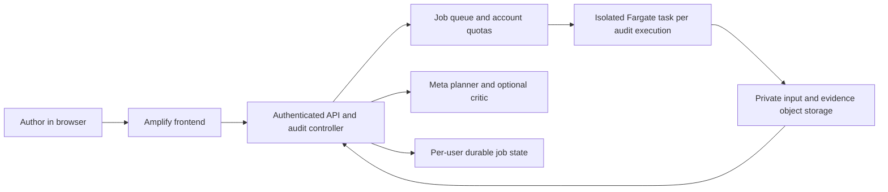

# Deployment decision — 4 November 2026

Deployment is optional based on the captured submission form: it lists a public repository and public three-minute video, with no required hosted-URL field. The current authenticated guide still needs final verification because it does not render through the verification tool. There is no separate deployment scoring category in the saved rubric, and hosting does not guarantee additional marks.

Owner steering on 4 November: keep cloud deployment and domain purchase off the critical path. Prioritize the working local product, correct evidence, source readiness and video. The AWS route below is an optional prepared route if public access is wanted later. A recorded public demo and a fresh hosted audit service remain different deliverables.

## What is ready

| Delivery | Current behavior | Hosting fit |
|---|---|---|
| Local Research Workdesk | Persistent question/uploads/thread, reviewed brief/plan, fresh supported audits, saved results and acknowledged Meta calls | Python 3.12 on the owner's workstation |
| Public evidence demo | Read-only public SECOM Evidence Lab and explanatory Architecture; no uploads, private history or new audits | Amplify Hosting, or private S3 plus CloudFront |
| Public fresh-audit service | Proposed; authentication, per-user state, execution isolation and account quotas remain unfinished | AWS control plane plus isolated Fargate jobs, or a separately tested Modal design |

`localhost:8099` is accessible from this machine. Buying a domain does not make it a public service. The current server checks loopback clients/hosts and uses local shared job files. The repository Dockerfile is a sandbox image, not a verified public web-service deployment image. A reverse proxy that bypasses the local boundary is not the proposed hosted architecture.

## AWS Amplify: prepared public demo

[AWS manual deployment](https://docs.aws.amazon.com/amplify/latest/userguide/manual-deploys.html) accepts a ZIP of static build contents without connecting Git. Our deployable package already has index.html at the ZIP root.

1. Build locally with `python scripts/package_demo.py`.
2. Use out/nulllab-public-demo.zip, not the project/source/evaluation ZIP or the entire working directory. It contains only explicitly public recordings and UI assets.
3. In Amplify Hosting, create an app, choose **Deploy without Git**, select the ZIP/manual-deployment route, and choose a branch such as production. This is a publication action; no AWS resources have been created by this research task.
4. Inspect the generated HTTPS URL, recorded-mode labels, both manufacturing examples, architecture controls and mobile layout. The Workdesk link explains how to run locally; fresh-audit controls remain unavailable and no backend/model request may occur.
5. Add the custom domain and the DNS records Amplify supplies. A domain from another registrar is supported; moving registration to AWS is unnecessary. Amplify offers a default amplifyapp.com URL and managed TLS. The domain can be connected after the initial public URL works. See [custom domains](https://docs.aws.amazon.com/amplify/latest/userguide/custom-domains.html).

A custom domain is optional for obtaining a public URL. DNS/certificate verification can take time. No hosting cost, partner-credit entitlement or production uptime is guaranteed here; check the account's current terms before creating resources. No paid cloud resources or domain purchases were performed.

For an existing AWS static-hosting setup, private S3 plus CloudFront is another suitable route. Use the S3 REST origin with Origin Access Control; the S3 website endpoint does not support OAC. See [AWS origin-access guidance](https://docs.aws.amazon.com/AmazonCloudFront/latest/DeveloperGuide/private-content-restricting-access-to-s3.html). Amplify is my simpler operational recommendation for this prepared static package, rather than a measured provider benchmark.

## Meta and partner options

The [official event page](https://cerebralvalley.ai/e/meta-ai-developer-hackathon) lists Baseten, Modal and Fireworks, with credits for selected participants. The published offers primarily concern open-weight model inference and compute; account eligibility must be checked separately. The public material reviewed does not establish a Meta-operated turnkey website host for NullLab.

If “vasten” meant **Baseten**, its [documentation](https://docs.baseten.co/overview) describes model serving and inference infrastructure. Meta's [hosted-provider guidance](https://dev.meta.ai/docs/muse-spark-open/deploy) includes Baseten for Muse Spark Open. This can supply reasoning inference; it does not by itself implement our user authentication, job ownership or safe execution service. We already use hosted Meta reasoning and do not need to provision GPUs for the recorded frontend.

**Modal** is a plausible partner option for a later hosted backend: it supports [FastAPI/ASGI web applications](https://modal.com/docs/guide/webhooks) and [isolated Sandboxes](https://modal.com/docs/guide/sandboxes). These are provider capabilities, not a claim that NullLab has been deployed or validated there. No partner-specific backend or open-weight model quality claim is shipped.

## Proposed AWS fresh-audit architecture

This is a proposed extension. It must replace shared filesystem/catalog assumptions with per-user ownership and durable job storage, enforce authentication and global spending limits, and keep provider credentials outside execution workers. Exports need authorized access and a defined data-retention/deletion policy. The same v2 contract, guards and evidence identity should remain authoritative.

Fargate supplies task-level isolated environments; containers within one task share resources, and privileged/Docker-in-Docker execution is unavailable. Treat each task as the execution boundary, not a nested Docker daemon. See [Fargate security considerations](https://docs.aws.amazon.com/AmazonECS/latest/developerguide/fargate-security-considerations.html). Our existing Linux/container behavior still needs bounded deployment-specific verification. Hosting the current process alone does not close these gaps.

## Local author operation

Run `python -m uvicorn app.server:app --host 127.0.0.1 --port 8099` with Python 3.12. Configure hosted inference through explicit environment variables or a gitignored .env based on .env.example. The local UI additionally needs NULLLAB_ALLOW_WEB_LIVE=1 and outbound acknowledgement. No key is required for rules/local execution or an appropriately configured unauthenticated loopback inference server.

Ignored out/jobs contains UUID job state and ledgers. Ignored out/workdesk holds SQLite investigations, messages, immutable uploaded materials, brief revisions and run links. The local queue admits four jobs with two workers; cancellation is cooperative. A restart marks interrupted jobs failed. Generated cases under examples/user-* and all input/export contents remain private unless deliberately shared. Provider timeouts do not establish remote cancellation or final billing. The portable static ZIP deliberately excludes this state and cannot offer the actual Workdesk.

The saved submission guide lists a public repository and public three-minute video; the currently accessible event detail page still requires authenticated verification. I recommend a public clickable demo for judge access, without claiming an independently reverified mandatory live-URL rule. Final video, public deployment, current rule checks and submission remain separate release tasks. This document researches and prepares the route; it does not deploy or submit anything.
