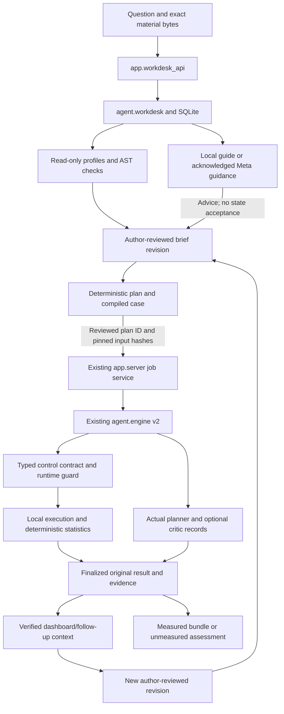

# NullLab Research Workdesk — design and implementation record

Initial design: 4 November 2026, Asia/Colombo. The original question/upload-first proposal has now been implemented as a local Workdesk and separate evidence/architecture pages. This record describes the implemented slice and its remaining gates; it does not label the initial planning task as implementation, retroactively validate old results or establish outside-user demand. Current rebuild browser, package, publication and release checks must be reported from the coordinator's actual evidence.

## Product decision and page map

The researcher's own investigation is the primary object: question → supplied materials → author-reviewed brief → bounded plan → explicit run → evidence/objections → new revision. Optional examples copy inputs into that workflow. Recordings remain read-only evidence, never an automatic answer to a fresh user's question.

| Page | Researcher intent | Current behavior |
|---|---|---|
| `/` | Understand NullLab and its scope | Hero, method, scope/evidence, continuous background animation with pause/reduced-motion support. Method links to the explanatory architecture. |
| `/workdesk` | Investigate my question | Start/continue an investigation; attach inputs; local or optional Meta guidance; review brief and plan; run and inspect actual evidence. |
| `/evidence` | Inspect how the method was demonstrated | “From claim to evidence”, labelled curated records and saved job history. No authoring/fullscreen requirement or model dispatch. |
| `/architecture` | Understand the model and instrument roles | Inspectable animated stages, responsibilities, inputs/outputs and limits; explicitly explanatory, not live activity. |

Opening the Workdesk does not auto-select a manufacturing outcome, create a project/job or invoke a model. Evidence Lab displays a clearly labelled retained recording; that display is not a new investigation. Existing `/?job=UUID` links open Evidence Lab. Space Mono headings and Inter body text are self-hosted. Workdesk has Research, Study brief, Results and Materials views for responsive navigation; long work can scroll. There is no requirement to fit every investigation into one viewport or fullscreen.

Initial audience remains authors/students reviewing supported binary tabular evaluations. Broad literature discovery, arbitrary research-question solving, paper/notebook reproduction and automatic scientific truth are outside the claim.

## Supported inputs and explicit source modes

| Input | Implemented use | Boundary |
|---|---|---|
| Question | Persistent investigation and local framing guidance | 1–4,000 characters; no measurement from a prompt alone. |
| CSV | Read-only profile, candidate target/class counts, reviewed task/roles and fixed generated baseline | UTF-8, up to 5,000,000 bytes; 30–20,000 rows, 2–1,000 columns, nonmissing binary 0/1 target with ≥5 records/class. |
| Compatible `.py` with CSV | AST compatibility inspection; supplied-pipeline mode after code acknowledgement | Up to 256,000 bytes; top-level `load(path)`, `feats(df)`, `claimed_eval(df, seed)` required. Shape compatibility does not establish safety or valid methodology. |
| `.txt`/`.md` notes | Author context with material references; bounded excerpts enter guidance/compiled claim | UTF-8, up to 256,000 bytes each. Assertions remain author-provided and excerpts are marked if truncated. |
| Bundled SECOM/SECOM-clean | Explicit atomic copy of data, Python and notes; then the same brief/plan workflow | Separate 50 MB local-case allowance for the bundled CSV; it does not import a stored score/result. |
| PDF, notebook, URL or another unsupported task | Scope explanation | No parser, remote retrieval, automatic execution or fabricated reproduction. |

Capacity is 20 attachments per project and 200 local investigations. HTTP material bodies are streamed with a 7,000,000-byte request bound. Source bytes, including line endings, are preserved; invalid UTF-8 is rejected. Original names are metadata, storage names are UUIDs, and reads verify hashes/containment. Unsupported file types or invalid CSV structure are rejected; syntactically invalid/incompatible Python can be retained as a visibly unsupported adapter, never silently executed.

**Generated baseline** uses the fixed Random Forest/average-precision protocol. Selected predictors must be numeric without infinity; missing values receive the template's recorded fixed zero replacement. Target, entity/time metadata and explicit exclusions are not generated predictors. This is not reproduction of an existing model/paper.

**Supplied pipeline** preserves the selected Python bytes, requires trusted-local-code acknowledgement tied to that file, checks a literal `TARGET` against the chosen CSV target and passes deterministic preflight. It is not silently substituted with the generated model. Custom-code feature-role declarations remain unverified. Local Python restrictions are not a public hostile-code sandbox; numeric external-reference reproduction is not newly supplied by this Workdesk UI.

The brief currently selects the latest attached CSV and latest Python for custom mode. Older versions remain stored; choosing among them and deletion/lifecycle controls are deferred.

## Researcher journey and real state

1. **Frame:** create an investigation with a question; attach available supported files. Question-only projects remain useful saved context without displaying a predetermined result.
2. **Inspect:** view file identities, CSV aggregate profile and Python compatibility. Profiling/parsing does not run uploaded Python.
3. **Declare:** choose generated/supplied mode and review target, intended use, prediction time, availability, population, unit, metadata and exclusions. Saving appends an author-reviewed brief revision, not verified scientific facts.
4. **Plan:** prepare a deterministic six-step plan and inspect method, gates and budget. Unknown facts produce questions; unsupported generated future/unseen-entity requests produce scope gaps. They do not compile a ready executable case.
5. **Run:** explicitly review and submit the current plan ID. Choose local rules or acknowledged hosted planning/optional independent critique. Real job events, baseline progress and attempted-call reservations appear; no invented progress percentage or fabricated agent dialogue is used.
6. **Review:** inspect finalized baseline/control where measured, conditional per-seed intervals, tested operations, objections, questions and limitations. Model-only and no-counterfactual outcomes remain distinct from empirical clearance.
7. **Continue:** add materials or edit declarations, save a new brief, prepare a new plan and explicitly run. Old results remain attached to their original inputs. Chat alone cannot rewrite a frozen experiment or trigger a rerun.
8. **Export/reopen:** reopen project/run/view links; obtain the matching verified evidence ZIP or unmeasured assessment ZIP where eligible. Investigation-summary JSON is separate from measured evidence. ZIPs include data/code and require review before sharing.

The active run and selected result are separate. Cancellation always targets the active job; exports target the displayed job. Follow-up guidance uses the **latest linked run**, not an arbitrarily selected older result, and the composer labels that distinction. Unsaved drafts are temporary client state rather than guaranteed server autosave.

## Implemented architecture

The initial proposal named separate store/material/intake/investigation/findings modules. The implemented bounded slice consolidates those responsibilities rather than adding a second orchestration framework:

| Source | Responsibility |
|---|---|
| `agent/workdesk.py` | SQLite metadata transactions, immutable materials, CSV profiling, AST shape inspection and brief validation. |
| `app/workdesk_api.py` | Investigation routes, local/optional Meta guidance, outbound context binding, plan compilation, run linking and verified result projections. |
| `app/server.py` | Existing local-origin/host boundary, routes, shared dispatch lock, queue, job status/cancellation, snapshots and exports. |
| `agent/study.py`, `agent/intake.py` | Declaration gates, role handling and trusted generated adapter. |
| `agent/engine.py`, `agent/provider.py`, `agent/evidence.py` | Existing measurement, provider accounting, typed controls/guard and evidence identity. |
| `app/static/workdesk.html`, `.css`, `.js` | Question-first interaction, drafts, materials/brief/plan, current job events and selected result. |
| Shared shell plus landing/evidence/architecture assets | Navigation, explanatory presentation and separately labelled recorded evidence. |

Metadata is stored in ignored `out/workdesk/investigations.sqlite3`; exact files in `out/workdesk/materials/UUID`. Short SQLite transactions do not span inference/execution. Example import stages all three inputs and commits one metadata change, rolling back staged files on failure.

A compiled case captures investigation/brief/plan IDs, accepted brief hash, question, material IDs/hashes and exact source hashes for `agent/workdesk.py` and `app/workdesk_api.py`. Question, intended use and bounded notes are in the engine's claim/excerpt, not merely project metadata. The full original attachments remain in local material storage; an exported engine bundle contains its manifest-bound case inputs, not an automatic copy of every original note attachment.

Dispatch rejects stale/missing plan IDs, changed compiled input hashes and dirty briefs. Material/brief/plan/example mutations are blocked during the investigation's active audit. The shared server lock prevents concurrent check-and-dispatch races; a job that cannot be linked is cancelled before execution. The existing global two-worker/four-active-job queue is reused, with one active audit per investigation. Cancellation is cooperative; restart marks interrupted jobs failed.

## Objects and API

| Persisted object | Current content |
|---|---|
| Investigation | UUID, title/question, timestamps, materials/messages, current and historical briefs/plans, run links. |
| Material | UUID, kind, original filename, byte count, SHA-256, timestamp, profile or compatibility status; immutable stored bytes. |
| Message | UUID, role/kind, text, material references, timestamp; model/ledger and reply linkage when available. All guidance is unmeasured. |
| Brief revision | UUID/parent ID, accepted declarations, selected CSV/Python/material IDs, source mode, code acknowledgement and deterministic review. |
| Plan | UUID/brief ID, method, six steps, questions/scope gaps/warnings, budget, compiled case and input hashes when ready. |
| Run link | Existing job UUID, brief/plan IDs, creation time; dashboard derives current status/evidence from the original job. |

There is no independent persisted Issue/Finding resolution object yet. Findings are views over saved engine records. Stable question IDs, field-level proposal provenance and author-source citations for each claim remain deferred.

Implemented routes are `GET /api/workdesk/config`; `GET/POST /api/investigations`; `GET /api/investigations/{id}`; material upload/read, message, brief, plan, run and example actions under that project. They reuse existing `/api/jobs/{job_id}` status/cancellation/export endpoints. A dashboard read triggers no inference or experiment. Arbitrary legacy-job linking/import is not implemented; old links/history retain their original evidence.

## Guidance consent, model roles and limits

Local study guidance works without a key and is labelled deterministic. Optional hosted guidance requires `NULLLAB_ALLOW_WEB_LIVE=1` and outbound acknowledgement. It records the actual intake-role model, returns a schema-validated text/questions/material-reference response and cannot accept the brief or execute a task.

For guidance, `context_sha256` binds consent to the question, current material IDs/hashes, accepted brief, recent thread and latest run context. The server verifies that context/material bytes under the lock and uses the authorized snapshot after releasing the lock for inference. A concurrent/new attachment cannot enter the already authorized request. Materials/brief/thread/run changes require renewed acknowledgement.

Outbound guidance includes recent messages, declarations, CSV columns/aggregates and bounded code/notes excerpts. Hosted audits receive the compiled research claim, complete pipeline, declarations and deterministic diagnostics. Neither path samples raw CSV rows into the prompt. Source, notes and prompts can contain private information themselves; no raw-row sampling is not a data-free guarantee.

Spark defaults to `muse-spark-1.3` for audit planning; Wonder defaults to `muse-wonder-1.0` for optional independent pre-plan review and interpretation critique. Deterministic gates, profiling, guard, execution and statistics are separate from these model opinions. Strict typed controls and scope limits still apply. Disagreements and failures are retained; model-only no-flaw is not measured clearance. Critic advantage has not been established against a matched one-planner baseline.

Guidance has one durable **four-attempt/$0.25 reserved** envelope per investigation; every hosted audit has its separate **four-attempt/$1 reserved** envelope. Failed attempts remain accounted. These are conservative reservations, not billed prices or promised completion. The originally proposed aggregate investigation/global budgeting is **not implemented**; the documented owner experiment ceiling remains an operational constraint, not a new global billing guarantee. There is no implicit credential path or model call on page load.

## Finality, privacy and original evidence

Only a terminal job with matching checkpoint status can provide a finalized result. Guidance/dashboard numerical context also verifies input/control evidence and measured-record identity. Running/failed-mismatch/unavailable snapshots do not become conclusions. Provisional baselines can be shown as progress, never as a tested counterfactual. Evidence Lab and Workdesk preserve active/selected identities and bind export links accordingly.

Assessment ZIPs explicitly say that no counterfactual was measured. Measured/assessment exports verify manifest-bound inputs and reject credential-like text; both include potentially private data and executable source. The investigation-summary JSON is a convenience record, not an independently verified measurement.

The historical SECOM construction/population/dispute caveats and fixed evaluation outcomes remain unchanged. In particular, the original ten-case 0/3 supported-control result remains separate from the later six-case confirmation. This Workdesk rebuild is workflow/engineering work, not a fresh scientific cohort or a broad accuracy claim. See [release evaluation](../EVAL-V2-RELEASE.md), [architecture](../ARCHITECTURE.md) and [roadmap](../RESEARCHER-ROADMAP.md).

## Completion gates and deferred scope

The implementation covers persistence, input inspection, author-reviewed declarations, local/optional bounded guidance, plan-bound existing-engine dispatch, history/results/exports and the page split. Completion claims still require current-source checks:

- Own-data generated and supplied-pipeline acceptance, exact byte identity and preserved custom source/model.
- Missing/unsupported gates; new material/brief invalidation; stale plan and consent rejection; active-run mutation/cancel/restart behavior.
- Finality and export consistency for pending, measured, model-only, failed, interrupted, mismatched and unavailable jobs.
- Desktop/mobile/keyboard/animation/accessibility checks under the owner's latest explicit browser-check instruction. Earlier “no browser walkthrough” planning restrictions do not describe that later authorization.
- Current assets/wheel/source packaging, manifests, docs and any newly authorized publication. Do not carry over prior release counts as proof for new bytes.
- Fresh fixed scientific evaluation if claiming changed instrument performance, external-user tasks before claiming usability impact, and recorded/uploaded video plus final authenticated rules/submission checks.

Current-source browser/packaging results and retained failures are reported in the [coordinator validation record](../reviews/2026-11-04-workdesk-validation.md), rather than inferred from this design. No model calls were needed to update this record. Outside researchers, broad accuracy, numerical judge scores and guaranteed competition outcomes remain unclaimed.

Deferred work includes stable issue/question IDs and field-source attribution, selecting/deleting material versions, arbitrary legacy-job import, selected-old-run chat context, aggregate budgeting, notebooks/repository imports, literature/dataset retrieval, validated local reasoning, collaboration and hosted isolated execution. The first release should keep the supported binary-tabular slice coherent rather than imply these broader research capabilities.

Planning schedule context remains internal **4 November 22:00 SLT / 11:30 ET** and hard deadline **5 November 07:30 SLT / 4 November 21:00 ET**. These times are planning constraints, not evidence that release/submission tasks are complete. Deployment/domain purchase is optional for the captured submission requirements and remains off the critical path.
