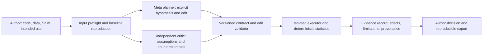

# NullLab independent architecture and hackathon evaluation

**Audit closure update:** The interrupted architecture review is now completed by the [follow-up report](2026-11-03-architecture-completion.md), with repeatable offline evidence. The owner excludes the browser walkthrough and defers the full offline suite until after the rebuild. Follow the revised ordering in the [implementation checklist](2026-11-03-implementation-checklist.md). Historical verification limitations described below are retained for traceability.

Reviewed 3 November 2026 for the **Indie Developer** track, confirmed by the owner in this conversation. This is an assessment and proposed direction, not an approved redesign. The owner has no outside researcher available; AI research-supervisor review is internal validation, not user research.

**Overall judgment.** NullLab has a credible, technically substantial research instrument, but the evidence and user experience do not yet support presenting it as a comprehensive multi-agent research platform. Its main weakness is the gap between a carefully prepared experiment and a new researcher successfully auditing their own work. More agents alone will not close that gap. The best near-term opportunity is a narrow author self-audit that turns a disputed evaluation assumption into a controlled experiment and a reproducible evidence package.

The current implementation does not warrant a confident first-place prediction. There is no basis for numerical win probabilities. The recommendations below prioritize what can improve a judged submission while preserving scientific honesty.

**What was reviewed and verified.** Three independent agent reviews covered [methodology](2026-11-03-methodology.md), [architecture](2026-11-03-architecture.md), and [product](2026-11-03-product.md). The coordinating review inspected the parent event/rules/rubric/strategy/checklist documents, the project README and product/security docs, source and recorded evidence, Git metadata, and current official Meta documentation. Existing strategy and decision files were treated as historical claims, not proof of effectiveness. Repository base: `3ef43cf`.

GitHub's connected repository metadata reports `RaveenDi/NullLab` as **public**. The official [event page](https://cerebralvalley.ai/e/meta-ai-developer-hackathon) confirms the themes, Meta tooling focus, Indie lens, and submission deadline: **5 November 07:30 SLT / 4 November 21:00 ET**. The internal target remains **4 November 22:00 SLT / 11:30 ET**, a 9.5-hour buffer. One parent README gives the wrong ET conversion for that internal target.

The current participant guide redirected to login and the waiver text could not be retrieved. Therefore the detailed rubric weights, anti-project wording, and submission requirements below rely on the saved 28 October summaries in `../02-RULES.md` and `../03-JUDGING-RUBRIC.md`, pending current organizer-page verification. They must not be described as freshly reverified official rules. Browser usability testing was not completed: the in-app browser could not reach the local demo, and native Computer Use stopped because it could not verify the browser URL. UI findings are source inspection, not an observed user session. No live inference, public posting, submission, deployment, or application-source changes were performed.

**Provisional score diagnosis.** These are my audit estimates using the saved rubric, not official scores, calibrated predictions, or a measurement of competing entries. Eligibility is a separate gate.

| Criterion | Weight | Present estimate / 10 | Main reason points are at risk |
|---|---:|---:|---|
| Impact | 30% | 4–5 | A real problem, but no external user evidence; substantial manual input adaptation; too many proposed audiences |
| Use of Meta AI tooling | 25% | 5–6 | Spark does substantive planning, but demonstrated value is narrow; no measured collaborative-agent benefit or working open-weight path |
| Technical depth and execution | 20% | 6–7 | Strong guards, experiments, traceability and tests; undermined by result identity, verdict semantics, engine divergence and portability gaps |
| Demo | 25% | 4–6 | Detailed replay evidence; no demonstrated new-input browser journey or verified deployed experience/video in this audit |
| Weighted total | 100% | **4.65–5.90** | Midpoint approximately **5.3**; uncertainty is judgmental |

Impact and Demo together account for 55% under the saved rubric. Improving the user's input-to-result journey can raise both. Another internal experiment variant or model badge is less likely to do that. The local strategy's “at least two Meta capabilities,” “product breaks without Meta,” and mandatory live-URL language are stronger than the cited rule summaries: treat those as strategic suggestions, not independently established eligibility requirements. A legitimate rules-only fallback does not invalidate meaningful Meta use elsewhere in the core workflow.

**What NullLab actually is today.** There are three separate systems:

1. The user's predictive ML model. NullLab runs original and modified evaluation code, which can fit or refit classifiers.
2. The Meta reasoning model. Muse Spark performs inference to propose changes; this repository does not train or fine-tune Spark. Wonder is an optional referee/probed alternative, not an evaluated research team.
3. NullLab's own evaluation benchmark. This must test whether the auditor makes legitimate interventions and sound conclusions on previously unseen projects.

The current product is a specialized Python/tabular ML evaluation auditor, with deterministic rules, an optional model planner, guards, execution, and reporting. Its web page presents recordings. It does not accept arbitrary papers, notebooks, repositories, datasets, or free-form research questions and perform general research evaluation. The proposed research agent room is a future product direction, not a description of shipped behavior.

**Highest-priority gaps, with evidence and completion criteria.**

| Priority | Finding | Why it matters | Concrete completion criterion |
|---|---|---|---|
| P0, submission | Hero evidence concerns civil-war prediction; display code scrubs domain/author terms | Saved rules flag political/war topics. The existing owner risk acceptance is not organizer approval | Obtain clear applicability guidance or use a genuinely nonpolitical primary example; retain truthful provenance and historical records |
| P0, trust | Stored evidence is not fully bound to current inputs | Changed data can inherit old experimental numbers | Change code, data, claim, or instrument version independently: every mismatch invalidates result reuse |
| P0, trust | Mixed evidence becomes `NOT INFLATED` | An unresolved experiment can look like reassurance | CLI, report and CI agree on tested/no-effect/unknown/unsupported states; uncertainty never becomes a clean verdict |
| P1 | The default hybrid engine is G5; strongest evaluated engine is G9 | User receives different planner/guard behavior from headline evidence | One versioned supported engine is exercised through the actual user command and evaluated as such |
| P1 | Fresh-clone live mode depends on sibling battle-station | A public repo and key are insufficient to run it | Supported installation works without private paths, while preserving local budgets and failure handling |
| P1 | Researchers must manually port code into a case contract | Adoption burden and risk of changing the experiment before auditing it | A guided supported import reproduces the starting score before any intervention, or stops with an explicit incompatibility |
| P1 | No unseen, matched evaluation validates current product | Known-case success can reflect tuning and guard prescriptions | Freeze the engine, assess fresh cases with hidden truth and matched baselines, count abstentions and failures |
| P1 if hosted | Python process restrictions are not safe public-upload isolation | Untrusted pipeline execution can affect the host environment | Keep execution to trusted local/curated cases until independently verified OS/container isolation exists |
| P2 | Cost, privacy and integration semantics need tightening | Failed calls may disappear from product cost totals; samples leave the machine; green CI can mean unchecked | Record attempts/outcomes/usage, preview payloads, and make CI coverage policy explicit |

Result identity is concretely weak in [agent/hybrid.py](../../agent/hybrid.py): `default_measure` around line 143 checks patch hashes but not the data hash; `find_recorded_spark` around line 162 matches a case basename and a successful record without code/data/claim identity. An offline temporary-fixture probe reproduced reuse after both source and data changed. `--fresh` does not disable the separate recorded-model lookup. Fix replay selection and caching as separate concepts, with explicit run IDs and immutable manifests.

The verdict bug is at `agent/hybrid.py:270`: any sign other than `+`, including `mixed`, becomes `NOT INFLATED`. An offline probe reproduced `['+', '-', '0'] -> mixed -> NOT INFLATED`. `agent/ci_check.py:48` also turns a referee-disputed measurement into PASS and permits an overall zero exit when cases are unchecked/unresolved. The warnings in the Markdown output are useful, but a green automation result can still communicate more coverage than exists.

The public hybrid uses `factorial_g5` and the static fidelity guard at `agent/hybrid.py:185`; G9's typed edits and behavioural checks are separate. Its older planner asks for two suspect steps, increasing pressure to manufacture an intervention on a clean input. The current docs disclose this separation, which is good; it remains an implementation gap.

The transport hardcodes `https://api.meta.ai/v1` in `agent/llm.py:14`; the `MODEL_BASE_URL` shown in `.env.example` is not read. The spend check depends on `../battle-station/bs.py`, and the default credential-file location is a private machine path. Preserve historical runners and frozen hashes; implement a new supported adapter/engine version instead of silently modifying the instrument behind published runs.

`sandbox/run.py:56` permits file opens under Python installation prefixes without restricting write mode. The audit hook also does not cover all filesystem mutation paths. This is a source-confirmed limitation, not a destructive exploit test. Hosting arbitrary uploaded code would require a different security boundary; adding a website upload button is not sufficient.

**Scientific strengths worth keeping.** Executed interventions, clean twins, reading and rule baselines, explicit failed runs, constrained edits, raw traces and freeze manifests are substantive work. G7's failed bar is honestly preserved. The product can produce patches and evidence that a researcher can inspect. These strengths are more defensible than a claim of universal research intelligence.

The clean-case distinction matters: every one of the five G7 and five G8 clean-twin runs contains executed statistics; they support no detected inflation for the tested controls. In G9/G9b, all eight clean units are model `no_flaw` decisions with **no experiment executed**. Zero false alarms is still a valid count, but those G9 results do not show that execution caused the improved specificity. The initial hypothesis, actual tests performed and final conclusion should be separate fields.

The latest evidence involves two underlying real dataset families already used in development. Identical repeats measure stability, not independent scientific replication across projects. The typed DSL was designed after seeing these cases; preregistration of a later run does not make them held out. The reading baseline and full planner also differ in instructions, output units and methodology contracts, so their difference is not a clean ablation of execution.

The row bootstrap resamples fixed predictions without refitting models or preserving group/time dependence. Three seed interval signs are majority-voted. Present these as conditional intervals for the specified experiment, not calibrated 95% confidence that a paper is wrong. Temporal controls can change the evaluation population, so the score difference is a change under a specified protocol, not automatically a pure causal amount of leakage. The UI's hardcoded `FALSIFIED` is stronger than the evidence warrants.

G9 robustness comes with narrower coverage: its documented historical replay gives 7/82 fully expressible plans, 46 partial, 29 not covered. The four edit families exclude feature edits and some other important flaws. Do not combine the capability of earlier flexible planners and the reliability of later restricted planners into a single untested product claim.

**Data leakage, in practical terms.** Leakage occurs when information unavailable at intended prediction time influences fitting or evaluation: preprocessing/feature selection on all rows, duplicate or related entities crossing splits, target-derived features, future information in forecasting, tuning on the final test, or evaluating synthetic resampling artifacts. This produces misleading generalization estimates and can invalidate comparisons or downstream conclusions. A high score alone neither demonstrates leakage nor rules it out.

Training fits parameters. Validation or inner cross-validation selects models, thresholds and hyperparameters. A final untouched test estimates performance after those choices are fixed. Preprocessing, feature selection and oversampling must be fitted within the training portion of each fold. Group and time splits must match the intended deployment task; no universal 80/10/10 ratio solves this. See the primary [scikit-learn guidance](https://scikit-learn.org/stable/common_pitfalls.html#data-leakage).

NullLab also needs its own independent benchmark split. If we change prompts or guards after inspecting a failing case, that case becomes development evidence. Disguising column names does not undo this exposure, and a model failing to name a source does not prove it never encountered that source during training.

**Real user experience and positioning.** Start with an ML author who owns their code/data and wants to check a result before submission. A reviewer may not have runnable artifacts; an institution has different procurement and privacy needs; a general student research assistant is a different product. Four audience names do not establish four validated workflows.

The proposed first flow is: select a supported local pipeline -> identify target, prediction time and grouping -> reproduce the reported baseline -> review a specific suspected assumption -> run a constrained control -> inspect effect, uncertainty and limitations -> export a patch and evidence. Failure to reproduce the baseline should stop the attribution claim rather than silently launch a different experiment.

Prioritize a local folder or narrow sklearn adapter with a guided preflight. A notebook adapter or GitHub/CI integration is a later connection after the same engine works reliably. A paper/PDF can supply a claim and intended-use context, but cannot replace missing executable code/data; that route should produce an evidence request, not a fabricated numeric audit. The UI should distinguish live run, rules-only execution, replay, model-only assessment and unsupported input. The existing browser bundle is recorded JSON; the CLI ZIP is a different reproducibility artifact and should be labelled accordingly.

With no outside researcher available, conduct an internal professor-style challenge: start from a clean environment and an independently prepared eligible case, time setup and required manual assistance, confirm baseline reproduction, challenge the control, and try applying the export. Report it as an internal task walkthrough. Do not invent testimonials, adoption, or human time saved. A small blind case set prepared by a separate agent can reduce direct prompt exposure, but remains internal AI evaluation and may share model biases.

**The research agent room: useful architecture, weak novelty by itself.** The [Popper paper](https://arxiv.org/abs/2502.09858) already describes LLM agents designing and executing falsification experiments. NullLab should not claim to invent agentic research or automated falsification. Its candidate distinction is an inspectable link from an ML evaluation assumption to a constrained intervention, measured effect, clean-control behavior and portable evidence. That distinction still needs validation against alternatives.

Use the proposed specialist roles as accountable functions, not a large unrestricted conversation. A small next version could have an intake/problem analyst, a planner/code analyst, and an independent methodology/dataset critic. The executor and statistics should be deterministic tools, not agents voting about numbers. Literature review should be added only when a concrete decision needs an external source.

Initial planner and critic assessments should be independent. Then allow one bounded challenge round. A shared evidence record should contain claim IDs, source/line references, assumptions, test proposals, input hashes, results, disagreements, and status. Agreement is not the stopping rule: sufficient evidence, exhausted budget, unsupported input, or unresolved disagreement is. Keep the ability to say “not tested” and “inconclusive.” Multiple agents using one model can share failure modes; different model names do not establish independent evidence either.

Evaluate rules, a matched reading-only Spark baseline, Spark plus execution, and Spark plus critic plus execution with comparable input/context and budgets. Measure end-to-end supported-case completion, false accusations on clean cases, detection on known flaws, invalid controls, abstentions, runtime and cost. Retain the critic only if it improves meaningful outcomes. Broad dataset discovery, general literature synthesis and autonomous new research can wait until this narrow loop works.

**Meta ecosystem choices, freshly checked.** The official [model catalog](https://dev.meta.ai/docs/models), [tool calling](https://dev.meta.ai/docs/tool-calling), [structured output](https://dev.meta.ai/docs/structured-output), and [search grounding](https://dev.meta.ai/docs/search-grounding) docs support the following opportunities. Capability availability is verified; quality in NullLab is not yet measured.

| Capability | Useful role | Priority and proof required |
|---|---|---|
| Spark reasoning with structured schemas and constrained tools | Produce auditable plans; validate/execute explicit operations and use errors to revise | First: demonstrate successful legitimate controls on new cases, not just valid JSON |
| Wonder as independent critic | Challenge split assumptions, interpretation and intervention fidelity | Optional small ablation; currently live referee benefit is unverified |
| Muse Glimmer open weights | Private institution-hosted or local planning/review | Strong future access/privacy story if it clears the same task evaluation |
| Search grounding | Locate methodological sources with citations | Only when needed; keep test answers and known corrections out of blinded benchmark context |
| PDF/long-context input | Extract a claim and compare methodology against code | Later: evaluate grounding and baseline fidelity; large context is not itself a benefit |
| SAM, image generation, voice | Possible later domain-specific input or accessibility | No present evidence these fix the core user problem; do not add just to increase model count |

**No API keys: three different promises.**

| Mode | Does user bring a key? | Actual feasibility |
|---|---|---|
| Current rules-only local audit | No | Works for supported patterns; missing rules require model/unknown status, not an all-clear |
| Current recorded demo | No | Inspects existing evidence; does not reason about new work |
| Operator-funded hosted Meta inference | No | Architecturally straightforward, but operator pays; requires quotas, privacy choices and safe execution; not implemented |
| Local/institution-hosted open weights | No external inference key once provisioned | Technically feasible; requires a configurable provider, runtime/hardware and quality/latency evaluation; not implemented |

Meta documents [Muse Glimmer](https://dev.meta.ai/docs/muse-glimmer) as a 30B text/image open model under Apache 2.0. Its [download guide](https://dev.meta.ai/docs/muse-glimmer/get-the-model) lists approximately 60 GB BF16 weights or a 17 GB Q4 text GGUF; [quantization guidance](https://dev.meta.ai/docs/muse-glimmer/quantization) describes a 24 GiB GPU configuration. CPU execution may be possible with adequate memory, but acceptable latency on the owner's laptop is unmeasured. The parent files report Intel UHD 620/no CUDA; this review's hardware query was denied, so hardware was not freshly verified. Spark Open is much larger and is a partner/server route, not a casual laptop deployment.

For multiple local roles, begin with one model server and bounded sequential requests instead of loading a model copy per agent. Quantization can affect tool/JSON fidelity and reasoning; use NullLab tasks to test it. No external key does not mean zero compute cost, universal laptop compatibility or equal reasoning quality.

Meta's current [pricing page](https://dev.meta.ai/docs/pricing-rate-limits) explicitly distinguishes Standard from Contributor mode: Contributor permits training on submitted content. Renaming columns is not anonymization. The prompt builder at `agent/factorial.py:44` includes the header and first five data rows along with code and excerpt. A privacy manifest should expose this before a new user's data is sent. Use appropriate standard/local handling for confidential material and separately inspect retention terms; “not used for training” does not mean no retention.

**Sequential improvement plan.** These are recommendations for our next discussion, not implemented changes or promises of finishing times.

1. Set the submission boundary: one target user, one supported task, one permissible hero. Resolve the political-example ambiguity without hiding provenance. Keep Build for Your World if that remains the owner's theme choice; an author self-audit fits it. Push the Frontier is also plausible, but changing themes alone does not improve evidence.
2. Repair evidence identity and conclusion states. Acceptance: changed files cannot retrieve old numbers; mixed/no-test/unsupported results cannot produce a reassuring clean verdict or misleading CI pass.
3. Ship one portable engine. Acceptance: a fresh clone can complete a new supported audit without battle-station, with bounded execution/spend and explicit provider configuration. Keep historical experiments frozen.
4. Complete one input-to-output experience. Acceptance: baseline reproduced, legitimate intervention inspected, result understood, export usable. Record internal walkthrough friction honestly.
5. Freeze and run a small fresh evaluation of that exact path. Include clean, leaky, ambiguous and unsupported cases; compare matched baselines; record all outcomes. Do not keep tuning on it while calling it held out.
6. Add a narrow critic only if there is sufficient time and an observed error it can fix. Open-weight deployment is an alternative substantive extension, not another mandatory workstream. Test it before claiming it.
7. Produce the three-minute evidence-backed demo and submission materials. Show one actual task and one meaningful failure/uncertainty state; label replay. Preserve the failed runs in the detailed evidence, without making the first screen an experiment-log tutorial. Verify public video/repo links and current rules before submission.

The first implementation focus should be **trustworthy result identity and verdict semantics**, after settling the permissible hero. The first product focus should be **a new author completing one supported audit**. Both are prerequisites to a convincing research room.

**Skills and working method.** Applied the existing workspace AI Engineering, Harness Engineering and Context Engineering skills; used specialist agents for independent critique and a coordinating review against code/results. No additional skill installation was needed for this assessment. A large skill catalog is not evidence of architectural competence. Going forward, keep a small current brief separating verified facts, proposed changes, accepted decisions, failed hypotheses and open questions; avoid treating old scores, compressed summaries or agent agreement as evidence. The parent README/AGENTS still describe obsolete finalists and paths, which is a concrete context-drift risk.

**Evidence and validation details.** See the three linked specialist reviews for precise source locations, offline reproductions, test results and limitations. Only new review documents were written; frozen research and application code remain unchanged. The absence of a live new-user run, external researcher, browser walkthrough and refreshed logged-in rules is recorded here so the assessment cannot be mistaken for completed validation of those items.
